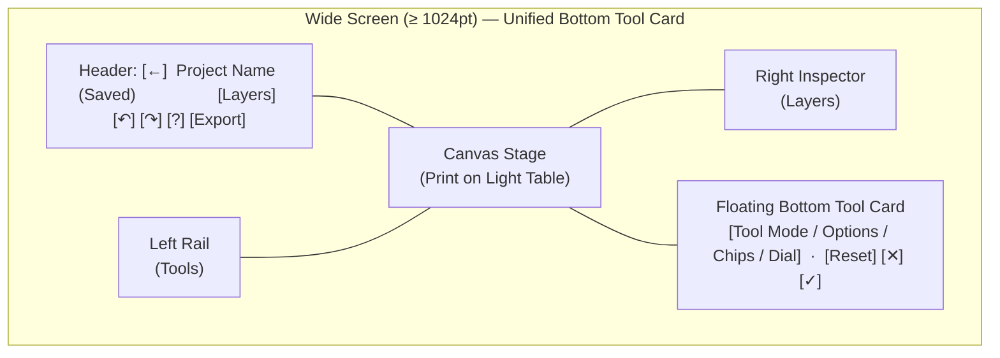

# UI/UX & Tooling Audit and Brainstorm

An audit of Tuck's current UI/UX shape—its tools, options, surfaces, layouts, and interaction patterns—followed by concrete ideas for rethinking and refining them while staying true to [PRODUCT.md](../../PRODUCT.md) (*"Seconds, not sessions"*, *"A utility, not a studio"*) and [DESIGN.md](../../DESIGN.md) (*"Print, Ink & Highlighter"*).

---

## Part 1: Audit of the Current Shape

### 1.1 Surface & Slot Architecture

The editor ([`Editor.tsx`](../../src/editor/Editor.tsx) and [`PanelViews.tsx`](../../src/editor/PanelViews.tsx)) adapts across three responsive breakpoints defined in [`editorFrame.ts`](../../src/editor/editorFrame.ts):
- **Phone / Narrow (`< 900pt`)**: Bottom `Dock` (`100pt` content + `44pt` footer), pop-up `Tray` / `Results` above the dock, and bottom sheets (`Layers`, `Stickers`, `Export`).
- **Medium (`900pt – 1023pt`)**: Keeps the bottom `Dock` and `Tray`, but moves `Layers` from a bottom sheet to a floating right-hand sidebar (`340pt`).
- **Wide (`≥ 1024pt`)**: Moves the main toolbar into a floating left `EditorRail` (`70pt` fine pointer / `84pt` coarse), moves tool options and `✕`/`✓` into the top header's `ContextBar`, replaces trays with `Popover`s anchored to `BarChip`s, places `Find` and `Adjust` controls into a bottom `ToolCard` (`maxWidth: 520pt`, `minHeight: 172pt`), and places `Layers` into a right-hand `EditorInspector` (`352pt`, pinned open when `height ≥ 960pt`, toggled via header button when shorter).

Every tool defines its UI by populating slots in `ToolViews<C>` ([`defineTool.ts`](../../src/editor/defineTool.ts)):

| Tool / Mode | Target | Phone `< 1024pt` Surfaces | Wide `≥ 1024pt` Surfaces | Commit (`✓`) & Cancel (`✕`) Behavior |
| :--- | :--- | :--- | :--- | :--- |
| **Idle** | — | `Dock`: 2-row `ToolGrid` (5×2 with photo, 3×2 blank) | `EditorRail` (left) + Project Title in `EditorHeader` | — |
| **Selected Layer** (`"layer"`) | Any non-text layer | `SelectionBar` (floating on canvas) + `Dock` (`LayerActionsPanel` + `DockFooter` with `✓` only) | `SelectionBar` (floating on canvas) + `ContextBar` (`LayerBar` + `✓` only) | `✓` deselects the layer; no `✕` |
| **Selected Text** (`edit` styling) | `TextLayer` | `SelectionBar` (floating) + `Dock` (`TextStylePanel` + `DockFooter` with `✓` only) | `SelectionBar` (floating) + `ContextBar` (`TextBar` + `✓` only) | `✓` deselects the text layer; no `✕` |
| **Text** (typing) | `"none"` | `Dock` (`TextStylePanel` riding keyboard) + `Results` (`TextColorPicker`) + `Draft` + `Input` | `ContextBar` (`TextBar`) + `Draft` + `Input` | `✓` / `⌘+Enter` / tap-away commits text; `✕` reverts session |
| **Draw** | `"none"` | `Dock` (`Brush`, `Shape`, `Eraser`, `Style`) + `Tray` (`BrushOptions`) | `ContextBar` (segments + `PenTipChip` / `ShapeKindChip`, `ColorChip`, `SizeChip`) | Live edits in session; `✓` / tap-away commits; `✕` reverts session |
| **Redact** | `"none"` | `Dock` (`Box`, `Brush`, `Eraser`, `Style`) + `Tray` (`RedactOptions`) | `ContextBar` (segments + `Effect` chip, `ColorChip`, `SizeChip`) | Live edits in session; `✓` / tap-away commits; `✕` reverts session |
| **Find** | `"photo"` | `Dock` (`Faces`, `Text`, `Both`, `Style`) + `Results` (`FindTray`) + `Tray` (`FindOptions`) | `ContextBar` (`FindBar`: effect & color chips) + `Card` (`FindCard`: scopes + results) | `✓` redacts chosen regions & closes; `✕` closes without redacting |
| **Sticker** | `"none"` | `Sheet` (`BottomSheet` with category tabs & grid) | `Sheet` (`Popover` beside the rail's Sticker button) | Picking a sticker adds it immediately and closes the sheet |
| **Crop** | `"none"` | `Stage` (`CropCanvas`) + `Controls` (tab controls strip) + `Dock` (`Crop`, `Rotate`, `Fill` tabs) | `Stage` (`CropCanvas`) + `Controls` (`100pt` dial strip on Rotate) + `ContextBar` (`CropBar`) | Draft state; `✓` reframes document in one step; `✕` discards draft |
| **Adjust** | `"image"` | `Dock` (`AdjustPanel`: 4 chips + `Dial` + floating `ChangingValue`) | `ContextBar` (title + `✕`/`✓` only) + `Card` (`AdjustCard`: 4 chips + `Dial`) | Live edits in session; `✓` / tap-away commits; `✕` reverts session |
| **Remove BG** | `"image"` | Action only (spins button in `Dock`, shows `Toast` with `Undo` · `Refine`) | Action only (spins button in `EditorRail` / `LayerBar`, shows `Toast`) | Immediate 1-step edit; `Refine` opens `Cut` |
| **Cut** | `"image"` | `Dock` (`CutPanel`: up to 9 buttons) + `Tray` (`CutOptions`: brush or `Apply` menu) | `ContextBar` (`CutBar`: segments, tap mode, resize, subjects, invert, `Apply` popover) | **`✓` and `✕` both call `cancelSession`!** Only an `Apply` menu action commits an edit |

---

## Part 2: Core UX & UI Friction Points Found

### 1. The `Cut` Tool's Commit Paradox & Control Overflow
`Cut` ([`CutPanel.tsx`](../../src/editor/tools/cut/CutPanel.tsx), [`useCutTool.ts`](../../src/editor/tools/cut/useCutTool.ts)) currently breaks two core mental models established by every other tool in the app:

1. **`✓` (Done) Discards Your Work**:
   - In `Crop`, `Find`, `Text`, `Draw`, `Redact`, and `Adjust`, pressing `✓` means *"apply/keep what I just did"* and pressing `✕` means *"cancel and put it back how it was."*
   - In `Cut`, `done` is wired to `cancelSession` ([`useCutTool.ts#L256`](../../src/editor/tools/cut/useCutTool.ts#L256)). If a user opens `Cut`, taps a person to select them (seeing the green/red preview wash), and taps `✓` (or presses `Escape` or taps outside the canvas), **their selection vanishes and nothing happens**. Both `✕` and `✓` do the exact same thing (`cancelSession`).
   - To actually use the selection, the user must notice and open the `Apply` (`dots-horizontal`) menu and pick one of five actions (`New layer`, `Keep only`, `Remove`, `Redact`, `Save sticker`).
2. **Dynamic Control Insertion Pushes `Apply` Off-Screen (Issue [#15](https://github.com/nverkhachoyan/tuck/issues/15))**:
   - `CutPanel` and `CutBar` place mode selection, sub-tool options, selection modifiers, and commit actions into a single horizontal scrolling strip:
     `Subjects` · `Tap` · `Add` · `Subtract` · `Adds/Subtracts` · `Smaller` · `Larger` · `Size` · `Invert` · `Apply`
   - The moment a user taps an object with `Tap`, `Smaller` and `Larger` mount in the middle of the bar, pushing `Invert` and `Apply` off the right edge—precisely at the moment the user needs `Apply` to finish their task.
3. **Overlap Between `Remove BG` and `Cut`**:
   - Both `Remove BG` and `Cut` sit side-by-side in the main toolbar and in an image layer's actions (`LayerActionsPanel`). `Remove BG` is a one-tap shortcut for `Cut → Subjects → Keep only`, bridged by a 5-second toast (`Background removed · Refine · Undo`) that often auto-dismisses before the user decides whether to refine (Issue [#13](https://github.com/nverkhachoyan/tuck/issues/13)).

---

### 2. Split Attention on Wide Screens (`ContextBar` vs. `ToolCard` vs. `Controls`)
On wide screens (`≥ 1024pt`), tool controls are distributed across three different vertical zones depending on the tool:

```
┌──────────────────────────────────────────────────────────────────────────┐
│ [←]  Tool Title   [ContextBar options...]       [✕] [✓] │ Reset ↶ ↷ Export│ ← Top Header (48/56pt)
├──────────┬──────────────────────────────────────────────────┬────────────┤
│          │                                                  │            │
│   Rail   │                   Canvas Stage                   │  Inspector │
│  (Tools) │                                                  │  (Layers)  │
│          │          ┌────────────────────────────┐          │            │
│          │          │  ToolCard / Crop Controls  │          │            │ ← Bottom of Canvas
└──────────┴──────────┴────────────────────────────┴──────────┴────────────┘
```

- **Empty Header Bar in `Adjust`**: Moving `Adjust` into `ToolCard` (in `64f5be7`) solved the problem of the dial being tucked into the far-right corner, **but left `ContextBar` completely empty** except for `"Adjust"` on the left and `✕`/`✓` on the right. The user adjusts the dial at the bottom of the photo, then has to move their pointer to the top-right header to click `✓`, `✕`, or `Reset`.
- **Split Controls in `Find`**: When `Find` is open on a wide screen, `Scopes` (`Faces`, `Text`, `Both`) and `Results` (`All`, `None`, `Review`) are in the bottom `ToolCard`, while the redaction style (`Solid` / `Blur` / `Pixelate` and `Color`) is up in the top `ContextBar`, and `✕` / `✓` ("Redact N") is in the top-right of `ContextBar`. When `FindResults` says *"Check the photo, then ✓ to redact"*, the user is reading that text in the bottom card while the `✓` button is at the top of the window.
- **Split Controls in `Crop`**: On wide screens, `Crop`, `Rotate`, and `Fill` tabs and their buttons (`Aspect ratio`, `Rotate 90°`, `Flip`, `Background`) live in the top `ContextBar`, while the `StraightenDial` lives at the bottom of the canvas in `CropControls` (`100pt` tall). Worse, `CropControls` reserves `100pt` of empty gray well at the bottom of the stage even on the `Crop` and `Fill` tabs where the strip is completely blank!
- **Constant `CARD_HEIGHT` (172pt) Over-Reservation**: `useEditorLayout.ts` reserves `CARD_HEIGHT = 172pt` whenever `cardOpen` is true. While `FindCard` needs ~172pt (a row of `ToolButton`s + a divider + status/results), `AdjustCard` only contains a row of `30pt` chips and a `28pt` dial (~78pt total), so it sits inside a `minHeight: 172` box with ~90pt of empty vertical whitespace while shrinking the photo above it.
- **Missing `ChangingValue` HUD on Wide Screens**: On a phone, `AdjustPanel` renders `<ChangingValue />` (a large `28px` tabular readout over the canvas while dragging). `AdjustCard` omits `<ChangingValue />`, leaving only the small `13px` readout above the dial ticks—even when the user drags sideways directly on a large desktop photo.

---

### 3. Inconsistent Layer Selection & Restyling Ergonomics
When a user selects an existing layer on the canvas (`mode.type === "idle"`, `selectedLayer !== undefined`), two things happen at once:
1. **`SelectionBar` floats next to the layer on the canvas** with universal layer actions: `[Edit]` (text only), `[Free resize]` (text/image), `[Arrange ▸]`, `[Duplicate]`, `[Delete]`.
2. **The `Dock` (phone) or `ContextBar` (wide) switches from `"idle"` to a layer panel**, with a footer/header showing the layer's type name and a `✓` button (which just deselects the layer).

However, **what appears in that Dock / ContextBar is inconsistent across layer types**:

| Selected Layer Type | What Shows in `Dock` / `ContextBar` | Can You Restyle It Immediately? |
| :--- | :--- | :--- |
| **Text** (`TextLayer`) | `TextStylePanel` / `TextBar` (Font, Color, Outline, Box, Align) via `textTool.edit` | **Yes** — 1 tap to change color, font, box, or align without entering typing mode. |
| **Shape** (`ShapeLayer`) | `LayerActionsPanel` showing a single `[Draw]` button | **No** — you must tap `Draw` first (which opens `Draw` in shape mode) just to change the rectangle/arrow's color or stroke width. |
| **Redaction** (`RedactionLayer`) | `LayerActionsPanel` showing a single `[Redact]` button | **No** — you must tap `Redact` first just to change a redaction box from Blur to Solid or adjust its strength. |
| **Drawing** (`DrawingLayer`) | `LayerActionsPanel` showing a single `[Draw]` button | **No** — tapping `Draw` enters `Draw` mode to add strokes to that drawing layer (`drawStroke` cannot restyle existing strokes' color/size). |
| **Photo** (`ImageLayer`) | `LayerActionsPanel` showing `[Redact]`, `[Find]`, `[Adjust]`, `[Remove BG]`, `[Cut]`, `[Sticker]` | **N/A** — offers photo-specific tools and `Sticker` (`Save as sticker`). |
| **Sticker** (`ImageLayer` w/ `sticker: true`) | Same as Photo (`[Redact]`, `[Find]`, `[Adjust]`, `[Remove BG]`, `[Cut]`) | Offers `Find`, `Redact`, `Remove BG` on an emoji/sticker, which is rarely what someone wants on a 56px emoji. |

**Why this matters:**
- Showing a single `[Draw]` icon in the entire `100pt` dock (or across the wide `ContextBar`) when a `Rectangle` or `Arrow` is selected is a wasted surface and an unnecessary extra tap. `useDrawTool` and `useRedactTool` *already* contain the logic to restyle a selected shape (`setShapeStyle`) or redaction (`setRedactionEffect`)!
- Having a `DockFooter` / `ContextBar` with `✓` when a layer is selected blurs the meaning of `✓`: in a tool, `✓` commits a mode; on a selected layer, `✓` just deselects (which tapping anywhere on the canvas or pressing `Escape` already does).

---

### 4. Phone Dock & Tray Ergonomics in `Draw`, `Redact`, and `Text`

1. **Tuck's Signature Tools (`Pen` vs. `Highlighter`) Are Hidden Behind 2 Taps in `Draw`**:
   - Tuck's visual identity and tagline are literally *"marked up in ink and highlighter."*
   - Yet on a phone, opening `Draw` shows only 4 buttons in the dock: `Brush`, `Shape`, `Eraser`, `Style`.
   - Switching from `Pen` to `Highlighter` (or `Marker` / `Neon`), or switching from `Rectangle` to `Arrow`, requires opening the `Style` tray, picking the tip/shape, and closing the tray.
2. **Hidden Double-Tap Affordance on Sub-Tools**:
   - In `DrawPanel`, `RedactPanel`, and `CutPanel`, tapping the already-highlighted sub-tool button toggles the options tray (`if (tool === settings.tool) toggleTray()`).
   - There is no visual cue (such as a small chevron or dot) on a selected `Brush` or `Shape` button to hint that tapping it again opens options, so users either don't discover it or trigger it accidentally when trying to confirm which tool is active.
3. **Phone Keyboard + Dock + Color Picker Stack in `Text`**:
   - On a phone, `TextStylePanel` uses 5 horizontal tabs (`Font`, `Color`, `Outline`, `Box`, `Align`) stacked above the tab content and `DockFooter` (`144pt` total), floating above the OS keyboard (`~260–300pt`).
   - When the user taps the rainbow custom color swatch in `Color`, `Outline`, or `Box`, `TextColorPicker` opens in `Results` *above* the dock (`~160pt`), covering almost the entire remaining canvas height above the keyboard.
   - Furthermore, having three separate tabs (`Color`, `Outline`, `Box`) that each display the exact same row of 8 swatches makes it easy to lose track of whether you are currently picking a fill, an outline, or a background box color.

---

### 5. Navigation, Header & Inspector Rough Edges

1. **`Reset` Placement Is Disconnected from the Controls It Resets**:
   - `Adjust`, `Crop`, and `Cut` provide a `reset` callback, which renders a text `Reset` button inside `HeaderActions` at the top right of the screen (`EditorHeader`).
   - On a phone, when using `Adjust` or `Crop`, the user's thumb is at the bottom dock/dial, while `Reset` is at the top right next to `Undo`.
   - On a wide screen, `Reset` sits in `HeaderActions` *to the right of* the context bar's `✕` and `✓` divider, visually grouped with document-level `Undo` / `Redo` / `Export` rather than with the active tool's own controls.
2. **Layers Button Disappears While Tools Are Open on Laptop Screens (`< 960pt` tall)**:
   - In [`Editor.tsx#L424`](../../src/editor/Editor.tsx#L424), `HeaderActions` receives `layers={!tool && !inspectorPinned ? ... : undefined}`.
   - On a tall monitor (`≥ 960pt`), the `EditorInspector` stays pinned open while you use `Draw`, `Redact`, `Adjust`, or `Find`.
   - On a 13-inch or 14-inch laptop browser (`height < 960pt`), `inspectorPinned` is `false`, **and** opening any tool hides the `Layers` toggle button in the header! And if you had `Layers` open before picking a tool, `editorModeReducer` forces `sheet: null` (`layersOpen = false`), closing the inspector with no way to reopen it until you exit the tool.
3. **Discoverability of `ShortcutsOverlay` (`?`) and Zoom Controls on Web**:
   - The keyboard shortcuts modal ([`ShortcutsOverlay.tsx`](../../src/editor/ShortcutsOverlay.tsx)) is a great feature on web, but it can *only* be opened by pressing `?` on the keyboard—there is no `?` icon button anywhere in the wide UI.
   - Similarly, zooming on web works via trackpad pinch, scroll wheel, double-tap, or `⌘+`/`⌘-`, and `FitButton` appears only *after* you have zoomed in. A user with a standard mouse without a pinch trackpad has no visible zoom control or zoom percentage indicator on screen.

---

## Part 3: Brainstorm — Rethinking Surfaces, Tooling & Interactions

Below are concrete directions for improving Tuck's UI/UX, organized into five themes. They can be adopted independently or combined.

---

### Theme A: Unifying Wide-Screen Surfaces (Ending the Top/Bottom Split)

Right now, wide screens (`≥ 1024pt`) split tool controls between the top `ContextBar` and the bottom `ToolCard` / `CropControls`. We have two clean ways to resolve this tension:

#### Idea A1: Move `ContextBar` into a Floating Bottom Dock Card on Wide Screens (Unified Bottom Chrome)
Instead of putting tool options in the top `EditorHeader` on wide screens *and* also putting `ToolCard` / `CropControls` at the bottom of the canvas:
- **Keep `EditorHeader` stable at all times**: `[← Back]   Project Title · Saved on this device   [Layers] [Undo] [Redo] [?] [Export]`.
  - This immediately eliminates **Issue [#19](https://github.com/nverkhachoyan/tuck/issues/19)** (*"A rail click right after a header ✓ or ✕ is lost"*), because the header never swaps between title and `ContextBar`.
  - `Export` and `Layers` stay in consistent positions.
- **Give wide screens a floating bottom `ToolBarCard` (centered along the bottom of the stage)**:
  - Every open tool renders its controls, `Reset`, `✕`, and `✓` in one cohesive floating paper card at the bottom of the canvas (just like `ToolCard` does today for `Find` and `Adjust`, and `CropControls` does for `Crop`).
  - **For `Adjust`**: The bottom card holds the 4 adjustment chips, the `Dial`, `Reset`, `✕`, and `✓` all in one place—no empty top `ContextBar`!
  - **For `Find`**: The bottom card holds the scopes (`Faces`, `Text`, `Both`), the `Style` chip (`Solid`/`Blur`/`Pixelate` + `Color`), the scan results/review controls, and `✕` / `✓ ("Redact N")` right where the user's eyes and pointer already are.
  - **For `Crop`**: The bottom card holds the `Crop` / `Rotate` / `Fill` controls, the `StraightenDial`, `Reset`, `✕`, and `✓`—all right below the crop box.
  - **For `Draw`, `Redact`, `Text`, `Cut`**: Their `BarSections` (`OptionSegments`, `BarChip`s, `ColorChip`, `SizeChip`) plus `✕` and `✓` sit in that same compact floating bottom bar (`48pt` tall), with popovers opening *above* the chips (`placement="above"`).



#### Idea A2: If Keeping the Top `ContextBar`, Make Bottom Surfaces Strictly Contextual & Right-Sized
If we prefer keeping `ContextBar` in the top header on wide screens:
1. **Right-size ` CARD_INSET` per tool instead of a fixed `172pt`**:
   - Give `ToolDefinition` a `cardHeight?: number` (or `"compact" | "tall"`): `Adjust` only needs `~88pt`, while `Find` needs `172pt`.
   - In `CropControls`, only reserve `DIAL_STRIP` (`100pt`) when `wide && controller.tab === "rotate" && anchor.layer`, or put the straighten dial inside a compact floating pill at the bottom of the crop stage so `Crop` and `Fill` tabs get the full stage height.
2. **Put `Adjust` chips in `ContextBar` and only the `Dial` (with `<ChangingValue />`) at the bottom, OR put `✕`/`✓`/`Reset` inside `AdjustCard`**:
   - Right now `Adjust` has an empty `ContextBar` with just the title `"Adjust"` and `✕`/`✓`. Moving `Reset`, `✕`, and `✓` into `FindCard` and `AdjustCard` (or putting `Adjust`'s 4 chips in `ContextBar` like `Crop` does with its tabs and keeping the bottom strip purely for the `Dial`) removes the awkward empty header bar.
3. **Add `<ChangingValue />` to `AdjustCard`**:
   - Show the `28px` figure HUD over the canvas when dragging the dial or dragging sideways on the photo on wide screens too.
4. **Move `Reset` into `ModeActions` (next to `✕` and `✓`)**:
   - Whether in `ContextBar` or `DockFooter`, `Reset` belongs to the active tool (`Adjust`, `Crop`, `Cut`), not to the global header's `Undo`/`Redo`/`Export` cluster. Placing `Reset` right beside `✕` and `✓` keeps all tool session actions together on both phone and desktop.

---

### Theme B: Rethinking `Cut` and `Remove BG`

`Cut` is Tuck's most powerful differentiator (on-device MobileSAM + subject segmentation + mask brushes + redaction/sticker/layer extraction), but its current UI has the highest friction.

#### Idea B1: Fix the `✓` Commit Paradox in `Cut`
Users expect `✓` to apply their work. Two clean ways to fix this:
- **Option 1 (Default `✓` to `"Keep only"`, or open the `Apply` sheet)**:
  - If the user has a non-empty selection (`selected !== undefined`) and presses `✓`, **either**:
    - Have `✓` perform **Keep only** (`keepOnly`, the most natural meaning of "Cut" and the exact behavior of editing an existing cut mask), while keeping the other outcomes (`Copy to new layer`, `Remove selection`, `Redact selection`, `Save as sticker`) in an `Actions` / `More…` button; **or**
    - Replace the generic `✓` icon in `Cut`'s footer/bar with a primary **`Apply ▾` / `Use selection ▾`** pill button when a selection exists! When nothing is selected yet, the footer shows `✕ Cancel` only. Once something is selected, the right-end action *is* the Apply menu.
- **Option 2 (Explicit Action Footer)**:
  - When a selection is active in `Cut`, the phone's `DockFooter` (or a strip above the dock) can show the primary actions directly (`Keep`, `Remove`, `New layer`, `Redact`, `Sticker`) instead of hiding all 5 behind `dots-horizontal` (`Apply`) at the far end of a scrolling tool row.

#### Idea B2: Solve `Cut`'s Control Sprawl (Issue [#15](https://github.com/nverkhachoyan/tuck/issues/15))
Why does `Cut` overflow? Because it puts **three different levels of controls** into a single flat row:
1. **Selection Tools**: `Subjects` (auto), `Tap` (smart object), `Add` (brush), `Subtract` (eraser)
2. **Sub-tool Modifiers**: `Adds / Subtracts` (for Tap), `Smaller / Larger` (after a Tap), `Size / Edge` (for Add/Subtract)
3. **Selection Actions**: `Invert`, `Apply`

**How to declutter `Cut`:**
1. **Move `Smaller` / `Larger` and `Adds / Subtracts` into a floating contextual pill above the dock (or into `views.Results` / `Controls`) when `Tap` is active**:
   - When `tool === "tap"`, the main dock row only needs: `Subjects` · `Tap` · `Add` · `Subtract` · `Invert` · `Apply` (6 items—fits every phone screen without scrolling, and never shifts when you tap an object!).
   - Above the dock (in `Results` or a compact pill), show `[ + Adds | − Subtracts ]` and, right after a tap, `[ − Smaller | + Larger ]`.
2. **Or combine `Add` and `Subtract` brushes into a single `Brush` sub-tool** (just as `Tap` has `Adds`/`Subtracts`), or pair `Tap` + `Brush` + `Eraser` as the 3 core modes (`Tap`, `Brush`, `Eraser`), with `Subjects` and `Invert` as compact icon actions.
3. **Unify `Remove BG` and `Cut` (or hide `Remove BG` when unavailable, Issue [#17](https://github.com/nverkhachoyan/tuck/issues/17))**:
   - Consider whether `Remove BG` needs to be a separate top-level tool button if `Cut` is fast and clear, **or** keep `Remove BG` for 1-tap speed and fix Issue [#13](https://github.com/nverkhachoyan/tuck/issues/13) by keeping toasts with a `secondAction` (`Refine`) visible for `8000ms` (and pausing the timer on pointer hover).

---

### Theme C: Direct Layer Styling & Rethinking Selection Surfaces

When a user taps an existing layer on the canvas, they almost always want to **move/resize it**, **restyle it**, or **delete/duplicate/reorder it**.

#### Idea C1: Direct Inline Styling for Selected `Shape` and `Redaction` Layers (Matching `Text`)
Currently, `Text` uses `definition.edit` ([`textTool.ts#L25-L31`](../../src/editor/tools/text/textTool.ts#L25-L31)) so that when a `TextLayer` is selected in `"idle"` mode, `TextStylePanel` (phone) or `TextBar` (wide) appears immediately in the dock/bar.
- **Extend this pattern to `ShapeLayer` and `RedactionLayer`**:
  - When a **Shape** (`rectangle`, `ellipse`, `line`, `arrow`) is selected in idle mode, show a compact **Shape Style Panel / Bar** (`Shape kind` · `Color swatches` · `Stroke size`) directly in the Dock / ContextBar! The user can change an arrow's color from red to yellow or make it thicker in **1 tap**, while still dragging its endpoints on the canvas.
  - When a **Redaction** (`box` or `strokes`) is selected in idle mode, show the **Redaction Style Panel / Bar** (`Solid` / `Blur` / `Pixelate` · `Color` or `Strength`) directly in the Dock / ContextBar! If a user drew a blur box and wants to switch it to Pixelate or Solid black, it takes **1 tap** on selection instead of tapping `Redact` → `Style` → `Pixelate` → `✓`.

#### Idea C2: Filter `LayerActionsPanel` for Stickers vs. Photos
- Currently, `ImageLayer` has `sticker?: boolean`, and `actsOn` in `findSpec`, `redactSpec`, `adjustSpec`, `cutSpec`, and `removeBgSpec` checks `layer.type === "image"`.
- That means tapping an emoji sticker opens a `Sticker` bar offering `Redact`, `Find`, `Adjust`, `Remove BG`, and `Cut`!
- **Fix**: For layers with `layer.type === "image" && layer.sticker`, either skip `find`, `removeBg`, and `cut` in `actsOn` (leaving `Adjust` if desired, or keeping the main toolbar visible so you can immediately add another sticker or text), while keeping the full photo toolset (`Adjust`, `Cut`, `Remove BG`, `Find`, `Redact`, `Save as sticker`) for actual photos (`!layer.sticker`).

#### Idea C3: Rethinking the `✓` Footer on Selected Layers
- When a layer is selected (and no tool is open), `DockFooter` and `ContextBar` show the layer kind (`Photo`, `Text`, `Rectangle`) and a `✓` button that deselects the layer.
- Tapping anywhere off the layer on the canvas (or pressing `Escape`) already deselects it.
- On a phone, the `44pt` `DockFooter` could either be omitted for passive layer selection (giving `144pt` to the dock or keeping the dock compact at `100pt` so the photo is larger), or on wide screens `ContextBar` can show a subtle `Deselect` / `✕` instead of `✓` (reserving `✓` strictly for tools where confirming an action/session has meaning).

---

### Theme D: Streamlining Individual Tools (`Draw`, `Redact`, `Text`, `Find`, `Crop`)

#### 1. `Draw`: First-Class `Pen` & `Highlighter` +Visible Options Affordance
- **Why**: In `DrawPanel` (phone), there are only 4 buttons (`Brush`, `Shape`, `Eraser`, `Style`), leaving plenty of horizontal room (`520pt` max width, 4 buttons = `224pt`).
- **Idea D1 (Promote `Highlighter` or Show Active Brush Name)**:
  - Option A: Split `Brush` into **`Pen`** (last opaque brush: Pen/Marker/Neon) and **`Highlighter`** in the phone dock (`Pen` · `Highlighter` · `Shape` · `Eraser` · `Style` — 5 buttons, which easily fits on a 375pt screen!). Switching between black ink and yellow highlighter—Tuck's signature workflow—becomes a single tap.
  - Option B: Label the first button with the active brush's actual name (`Pen`, `Highlighter`, `Marker`, `Neon`) and add a small `▾` / `▴` chevron next to the label of whichever sub-tool (`Pen ▾`, `Rectangle ▾`, `Eraser ▾`) is currently selected to show that tapping it again opens its tray!
- **Idea D2 (Show Size + Color Together on the `Style` Button)**:
  - Currently `DrawPanel`'s `Style` button shows a `22×22` square of the current color, but gives no indication of the current brush size until you open the tray. Drawing the `SizeDot` in the brush's color inside a subtle frame (or showing `Color` and `Size` as two separate buttons in the dock) lets users see both their color and thickness at a glance.

#### 2. `Text`: Flattening the Phone Tab Hierarchy & Keyboard Stack
- **Problem**: On a phone, `TextStylePanel` has 5 tabs (`Font`, `Color`, `Outline`, `Box`, `Align`). Three of those tabs (`Color`, `Outline`, `Box`) render the exact same row of 8 color swatches, and `Align` renders just 3 buttons in a wide empty row.
- **Idea D3 (Consolidate `TextStylePanel` on Phone)**:
  - **Cycle `Align` in 1 tap**: Instead of a dedicated `Align` tab that opens 3 buttons (`Left`, `Center`, `Right`), make `Align` a single icon button at the end of the tab bar (or beside the font row) that cycles `Left → Center → Right` on each tap, showing the current alignment icon! That reduces 2 taps (`Align tab` → `Center`) to **1 tap** and frees a tab slot.
  - **Unified Color Row with Target Pill (`Text` · `Outline` · `Box`)**, or **Visual Swatch Indicators**: Keep `Font` as the default view, with compact quick-toggles for `Align`, `Outline` (on/off), and `Box` (on/off).
  - **Compact Inline Custom Color Slider over Keyboard**: When picking a custom color while typing on a phone, instead of mounting a full `ToolOptions` tray *above* the `144pt` dock (which covers the canvas over the keyboard), temporarily swap the `100pt` dock content itself to the `ColorPicker` with a `← Back` button! That way the dock height (`144pt`) never grows and the text on the canvas stays in full view above the keyboard.

#### 3. `Find` & `Redact`: Bridging Automatic and Manual Redaction
- **Current Friction**: `Redact` (manual box/brush) and `Find` (auto face/text detection) are two separate top-level tools, even though they share `useRedactLook` and produce the exact same `RedactionLayer`s. When `Find` finds nothing (or misses one license plate or name), `FindPanel` says *"Draw a box over it with Redact instead"*, requiring the user to finish `Find` (`✓`), go back to the toolbar, and open `Redact`.
- **Idea D4 (Direct Handoff or Unified Redact Flow)**:
  - **Quick Bridge**: In `Find`, when `state.status === "empty"`, make the action button **`Open Redact`** (calling `startTool("redact", image)`) instead of just `Close`! And even when `state.status === "found"`, offer a `+ Draw box` action (or let `✓` in `Find` have a secondary option to refine in `Redact`) so if detection found 4 of 5 faces, the user can immediately drag a box over the 5th without losing momentum.
  - **Auto-Start Last Scope in `Find`**: Currently, opening `Find` starts in `status === "idle"` showing *"Pick what to look for, then tap what's found to choose what to redact."* Why wait for a second tap? Remember the last-used scope (`faces`, `text`, or `both`, defaulting to `both` or `faces`) or offer a 1-tap scan on open so results appear immediately.

#### 4. `Crop`: More Direct Controls & Less Dead Space
- **Idea D5 (Flatten `Crop` & `Rotate` on Wide Screens, and Improve Phone Strip)**:
  - On wide screens (`CropBar`), `Crop` has only 1 control (`AspectMenu` chip), `Rotate` has 2–3 buttons (`Rotate 90°`, `Flip`, `Turn layers`), and `Fill` has 1 chip (`BackgroundChip`). They don't need to be hidden behind 3 mutually exclusive tabs (`Crop`, `Rotate`, `Fill`) on a `1024pt+` bar!
  - Showing `[Aspect: Free ▾]  |  [Rotate 90°] [Flip] [☐ Turn layers]  |  [■ Background ▾]` all at once in `CropBar` (and keeping the `StraightenDial` visible at the bottom whenever there is a photo) eliminates tab-switching in `Crop` on desktop/iPad!
  - On phones, when `tab !== "rotate"`, don't reserve `120pt` (`CONTROLS_WITH_DIAL`) if a smoother transition or a single unified Crop+Rotate view can keep the photo larger.

---

### Theme E: Layers, Canvas & Micro-Interaction Polish

1. **Keep the `Layers` Button Accessible on Short Wide Windows (`< 960pt` tall)**:
   - In [`Editor.tsx#L424`](../../src/editor/Editor.tsx#L424), allow `Layers` to be toggled on wide screens even when a non-draft tool (`Draw`, `Redact`, `Adjust`, `Find`) is open, or whenever `wide && !inspectorPinned && !draftOpen`. On a 13" laptop, a user in `Draw` or `Adjust` should be able to open the `EditorInspector` just like a user on a 27" monitor has it open.
2. **Layer Row Quick Actions (`Duplicate` & `Rename` / Better Labels)**:
   - In `LayerRow.tsx`, each row has `Hide` (eye), `Lock` (lock), and `Delete` (trash), while `Duplicate` is only in the canvas `SelectionBar` (or `⌘+D`).
   - Adding a `Duplicate` action (or giving `Drawing` layers a small color swatch badge on their thumbnail icon so multiple drawings aren't just identical `"Drawing"` rows) makes the Layers panel much easier to scan when a project has 5+ marks.
3. **longer / Hover-Aware Toast for Multi-Action Notices (Issue [#13](https://github.com/nverkhachoyan/tuck/issues/13))**:
   - In `useEditNotice.ts` and `Toast.tsx`, when a notice includes a `secondAction` (like `Remove BG`'s `Refine`), increase `SHOWN_MS` from `5000ms` to `8000ms` and pause the dismissal timer on web while the pointer hovers over the toast.
4. **Visible Keyboard Shortcuts (`?`) & Zoom Affordance on Web**:
   - Add a subtle `?` `IconButton` (with tooltip `"Keyboard shortcuts · ?"`) in the wide editor's `EditorRail` footer (or `HeaderActions`), so desktop users can discover all keyboard shortcuts (`T`, `D`, `R`, `F`, `A`, `C`, `E`, `G`, `B`, `[ ]`, etc.) without guessing that `?` exists.

---

## Part 4: Prioritized Summary Matrix

| Priority | Area | Proposal | Impact | Effort |
| :--- | :--- | :--- | :--- | :--- |
| **P0 (High Impact, Low/Med Effort)** | **Cut Tool** | **Fix `✓` Commit Semantics & Overflow ([#15](https://github.com/nverkhachoyan/tuck/issues/15))**: Make `✓` apply `Keep only` (or turn the primary action into `Apply ▾`), and move `Tap`'s `Adds/Subtracts` + `Smaller/Larger` out of the main tool row into a floating contextual pill above the dock. | Eliminates accidental lost selections & off-screen `Apply` button | Small–Medium |
| **P0 (High Impact, Low Effort)** | **Text (Phone)** | **Inline Custom Color Picker in Dock & 1-Tap Align**: Swap the dock's `100pt` content to `ColorPicker` instead of stacking `Results` above the dock+keyboard; make `Align` a 1-tap cycling icon button. | Frees canvas visibility while typing on phones; saves taps | Small |
| **P0 (High Impact, Low Effort)** | **Crop (Wide)** | **Flatten `CropBar` on Wide Screens & Dynamic `CropControls` Height**: Show `Aspect`, `Rotate 90°`, `Flip`, and `Background` together in `CropBar` without tab switching; stop reserving `100pt` when the dial isn't shown. | Removes unnecessary tab switching on desktop/iPad; larger crop stage | Small |
| **P1 (High Impact, Med Effort)** | **Selection Styling** | **Direct Inline Styling for Selected `Shape` and `Redaction` Layers**: Use `definition.edit` (or selection styling) so tapping a Shape or Redaction immediately shows its color/size/effect controls in the Dock/Bar, matching `Text`. | 1-tap restyling of arrows, boxes, and blurs without entering a tool mode | Medium |
| **P1 (Med/High Impact, Low Effort)** | **Draw (Phone)** | **First-Class `Pen` & `Highlighter` in `DrawPanel` + Sub-Tool Chevron**: Split `Brush` into `Pen` and `Highlighter` (or show a `▾` indicator on the active sub-tool) and reflect brush size on the `Style` button. | Makes Tuck's signature ink + highlighter workflow 1 tap on phones | Small |
| **P1 (Med/High Impact, Low Effort)** | **Wide Layout (`Adjust` / `Find`)** | **Right-Size `ToolCard`, Add `<ChangingValue />` to `AdjustCard`, & Move `Reset` to `ModeActions`**: Size `AdjustCard`'s reserve to `~88pt` instead of `172pt`, show the `28px` value HUD on wide screens, and place `Reset` next to `✕`/`✓`. | Cleaner wide layout, larger photo preview, cohesive tool actions | Small |
| **P2 (Architectural Polish)** | **Wide Chrome** | **Evaluate Unified Floating Bottom Tool Card on Wide Screens (Idea A1)**: Keep `EditorHeader` static (fixing [#19](https://github.com/nverkhachoyan/tuck/issues/19)) and house all active tool options + `✕`/`✓` in a single bottom surface. | Eliminates top-bar vs. bottom-card eye travel across all tools | Medium–Large |
| **P2 (Polish)** | **Find, Toasts, Web Chrome** | **Bridge `Find` Empty State to `Redact`, Extend Toast Timer for `Refine` ([#13](https://github.com/nverkhachoyan/tuck/issues/13)), Keep `Layers` Toggle on `<960pt` Wide Screens, Add `?` Button**: Smooths out edge cases across tools. | High polish and discoverability | Small |
