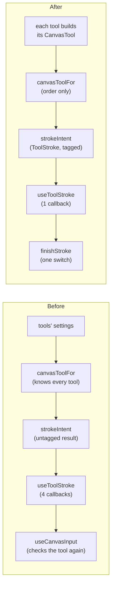

# Each tool's canvas input

A refactoring plan for how the editor's tools act on the canvas, written October 26, 2026. It picks up the item that `follow-ups-plan.md` §3 set aside ("Each tool's canvas input"). The tool code now sits in each tool's folder, and tools may import `canvas/`. But what a tool *does* on the canvas is still decided outside the tool, in six files, each of which switches over every kind of canvas tool. A stroke's kind is also decided three times before it reaches the document.

This plan changes APIs, not only where files sit: `EditorCanvas`'s props, `StrokeIntent`, and `canvasToolFor`'s inputs. Nothing the user sees or does changes.

## What happens today

Read at `164bad9`. Paths are under `src/screens/editor/`.

`CanvasTool` (`canvas/canvasInput.ts`) has seven kinds: `draw`, `drawShape`, `pickColor`, `redactBox`, `redactBrush`, `cutBrush`, and `pickSubject`. `CanvasInput` has five: `select`, `tool`, `editText`, `find`, and `adjust`. These places decide something per kind:

| File | What it decides | Switches over |
| --- | --- | --- |
| `canvasInputFor.ts` | `canvasToolFor` turns the eyedropper and the settings of Cut out, Draw, and Redact into a `CanvasTool`. `canvasInputFor` picks the input. | the tools, by name |
| `canvas/canvasInput.ts` | `inputRules`, `drags`, `restyles`, `canAddTo`, `cutImageId`, `outlinedLayerFor` | `CanvasTool` 4 times, `CanvasInput` twice |
| `canvas/strokeIntent.ts` | What a finished stroke means: pick, paint, box, shape, select, tap away | `CanvasTool`, in six `if`s |
| `canvas/useToolStroke.ts` | Sends each intent to one of four callbacks. Also decides when a stroke straightens and which layer it joins. | `StrokeIntent`, `CanvasTool` |
| `useCanvasInput.ts` | What each callback does with the document | `CanvasTool` again, in six `if`s |
| `canvas/LiveStrokeOverlay.tsx` | How a live stroke is drawn | `CanvasTool`, twice |

### A stroke's kind is decided three times

1. `canvasToolFor` picks the kind, say `redactBox`.
2. When the stroke ends, `strokeIntent` turns it into `{ type: "box", rect }`. The tool isn't part of the result.
3. `useToolStroke` calls `onDrawBox(rect)`. That's one of four `EditorCanvas` props: `onPaintStroke`, `onDrawBox`, `onDrawShape`, and `onPickPoint`.
4. `useCanvasInput`'s `onDrawBox` checks `canvasTool?.type === "redactBox"` again before it calls `addRedactionBox`.

Each callback does nothing for a kind it doesn't expect. `onPaintStroke` takes `number[]` and works out from the closed-over `canvasTool` whether to draw, redact, or cut. TypeScript can't check that these two decisions agree, because what crosses between them carries no tag.

### Find's state comes in two ways

The `find` input carries `imageId` and `onToggle`. The regions it toggles come in as a separate `detections` prop, which `EditorScreen` works out with its own copy of `canvasInputFor`'s rule:

```tsx
detections={tool === "find" && !eyedropper ? tools.find.overlay : undefined}
```

`useFindTap` takes the whole `CanvasInput` and returns early unless it's `find`. `useDialDragGesture` takes `input.type === "adjust" ? input.drag : null`. So the mode hooks each take their input in a different way.

### Why now

`follow-ups-plan.md` §4 lists Pick gestures that would be new canvas tool kinds: points that subtract, and a drag for a box. Today a new kind needs changes in about ten places across six files. After this plan, a kind that only paints or picks needs its union member, its row in one table, its builder in its own tool, its case in `finishStroke`, and its live drawing.

## The change



## Decisions

* **A finished stroke is its tool plus what the stroke made.** Add `ToolStroke` to `canvas/canvasInput.ts` (`canvasTool.ts` after step 4), one member for each `CanvasTool` kind:

  ```ts
  export type ToolStroke =
    | (Extract<CanvasTool, { type: "draw" | "redactBrush" | "cutBrush" }> & { points: number[] })
    | (Extract<CanvasTool, { type: "redactBox" }> & { rect: Rect })
    | (Extract<CanvasTool, { type: "drawShape" }> & { placement: ShapePlacement })
    | (Extract<CanvasTool, { type: "pickColor" | "pickSubject" }> & { point: Point });
  ```

  The members share `type` with `CanvasTool`, so `useCanvasInput` handles a stroke with one exhaustive `switch (stroke.type)`, each case already narrowed: `case "redactBox": actions.addRedactionBox(stroke.rect, stroke.effect)`. A nested `{ type: "box"; tool }` would make the reader switch twice, and TypeScript doesn't narrow an object by a property of a property.
* **The canvas still handles what stays on the canvas.** `StrokeIntent` becomes `{ type: "finish"; stroke: ToolStroke }`, `tapAway`, `select`, or `none`. `useToolStroke` keeps handling `tapAway` and `select`, which need the canvas's hit testing, and sends `finish` to the one new prop.
* **`CanvasTool` stays plain data.** No methods and no callbacks on it. Tests compare it with `deepEqual`, it's a memo dependency, and `LiveStroke` carries it into the scene.
* **Each tool builds its own `CanvasTool`, in its settings module.** `brushFor`, `shapeStyleFor`, `maskBrush`, `redactionEffect`, and `cutBrush` already live there. Only `canvasToolFor` calls the first four and `cutBrush`, and it puts their results together. The settings modules are pure and tested in Node. They import `CanvasTool` with `import type … from "../../canvas/canvasInput.ts"`, which `biome.json` allows for tools since `7afc71a`. `canvasToolFor` keeps only the order: the eyedropper, then Cut out, Draw, and Redact.
* **A table for what each kind's stroke does, but `canAddTo` stays a switch.** Each kind gets a row in one table: how its stroke works, and which layer kind it restyles. `drags`, `restyles`, and `strokeIntent`'s checks read the table. Only `draw` and `redactBrush` join a layer, and each has its own rule (the blend, and `shape === "strokes"`). Putting those rules in the table would need a per-kind function type, which a mapped table can only call with a cast. This is the smallest gain in the plan, so step 3 can be left out without affecting the others.
* **The five-mode `CanvasInput` moves to the root, and `canvas/canvasInput.ts` becomes `canvas/canvasTool.ts`.** Inside `canvas/`, only `CanvasTool`, `CanvasLookups`, and `canAddTo` are imported (by `useToolStroke`, `LiveStrokeOverlay`, and `useCanvasCursor`). `CanvasInput`, `inputRules`, and `outlinedLayerFor` are imported only by `EditorCanvas`, `canvasInputFor.ts`, and `tools/find/useFindTap.ts`. They describe how the editor's modes take turns on the canvas, which is composition, and that belongs at the root beside `canvasInputFor`. Step 5 needs this: the `find` member's regions are `DetectionOverlayRegion` from `tools/find/`, which `canvas/` may not import but the root may. Grow `canvasInputFor.ts` rather than add a file. With `CanvasInput` gone, `canvasInput.ts` would be a misleading name for what `canvas/` keeps.
* **Find's regions go into the `find` input. Text and Adjust stay as props.** The regions are used only while the input is `find`, so carrying them there drops `EditorScreen`'s copy of the rule. `textEdit` is different: it's drawn while the eyedropper picks a text color, when the input is `pickColor`. `adjusting` is drawn for the adjusted image whatever the input is. The reducer would let the eyedropper start during Adjust, though no Adjust panel opens it. Both stay props.
* **`EditorCanvas` keeps calling each mode's gesture hook by name.** Hooks have to run every render, in the same order, so a table of hooks would call every entry anyway. The hooks' arguments would only move into a bigger object. Instead, each mode hook takes its own input, or null (step 4).
* **`LiveStrokeOverlay` keeps its switches.** Each case draws with that kind's own fields (`tool.brush`, `tool.effect`, `tool.shape`), and the switch is what narrows them.

## Steps

Each step is its own commit and passes `npm run check`, `npm run typecheck`, and `npm test`.

### 1. Tag a finished stroke with its tool

* Add `ToolStroke` to `canvas/canvasInput.ts`, as above.
* `canvas/strokeIntent.ts`: replace the `pick`, `paint`, `box`, and `shape` intents with `{ type: "finish"; stroke: ToolStroke }`. Build each stroke by spreading the narrowed tool (`{ ...tool, points }`, `{ ...tool, rect: box }`). Keep `tapAway`, `select`, and `none` as they are. Update `canvas/__tests__/strokeIntent.test.ts`: each `finish` case expects the tool's fields as well.
* `canvas/useToolStroke.ts`: replace `onPaintStroke`, `onDrawBox`, `onDrawShape`, and `onPickPoint` with `onToolStroke?: (stroke: ToolStroke) => void`. The `handleStroke` switch shrinks to `finish`, `tapAway`, `select`, and `none`.
* `EditorCanvas.tsx`: the same four props become `onToolStroke`, with a doc comment ("A finished stroke with a tool, in document space"). Update the component's doc comment where it names the callbacks.
* `useCanvasInput.ts`: replace the four handlers with `finishStroke(stroke: ToolStroke)`, one `switch (stroke.type)` with a case per kind. `pickColor` keeps the eyedropper's async sample, `apply`, custom color, and `stopEyedropper` as they are. `pickSubject` calls `cut.pickSubject`. Return `{ input, onToolStroke: finishStroke }`, so `EditorScreen`'s `{...canvasInput}` spread doesn't change.

`refactor: hand the editor a finished stroke with its tool`

### 2. Let each tool build its canvas tool

* `tools/draw/brushSettings.ts`: add `drawCanvasTool(settings: BrushSettings, size: Size): CanvasTool`, the `drawShape` or `draw` branch of `canvasToolFor`.
* `tools/redact/redactSettings.ts`: add `redactCanvasTool(settings, size)`, the `redactBrush` or `redactBox` branch.
* `tools/cutout/cutOutSettings.ts`: add `cutCanvasTool(layerId, settings, tool, size)`, the `cutBrush` or `pickSubject` branch.
* `canvasInputFor.ts`: `canvasToolFor` calls these three in its order and imports nothing else from the tools. Its doc comment keeps "first match winning".
* Tests: move the branch cases from `__tests__/canvasInputFor.test.ts` to each tool's settings test: the brush and shape cases to `brushSettings.test.ts`, box and brush to `redactSettings.test.ts`, brush and pick to `cutOutSettings.test.ts`. `canvasInputFor.test.ts` keeps the order: the eyedropper wins over a tool, Cut out over Draw, and Find and Adjust have no canvas tool.
* `brushFor`, `shapeStyleFor`, `maskBrush`, and `cutBrush` no longer have callers outside their modules. Keep them exported anyway, since their own tests call them.

`refactor: let each tool build the canvas tool it draws with`

### 3. Read each canvas tool's stroke from one table

In `canvas/canvasInput.ts`:

```ts
// How each kind's stroke works: paints along its path; drags out a box or a
// shape between its ends; picks the point where it ends; or picks where a
// tap lands, dropping a drag. And the kind of layer it restyles when that's
// selected, and moves while dragging out.
const CANVAS_TOOLS: Record<
  CanvasTool["type"],
  { stroke: "paint" | "dragOut" | "pickAtEnd" | "tap"; restyles: "redaction" | "shape" | null }
> = {
  draw: { stroke: "paint", restyles: null },
  drawShape: { stroke: "dragOut", restyles: "shape" },
  pickColor: { stroke: "pickAtEnd", restyles: null },
  redactBox: { stroke: "dragOut", restyles: "redaction" },
  redactBrush: { stroke: "paint", restyles: "redaction" },
  cutBrush: { stroke: "paint", restyles: null },
  pickSubject: { stroke: "tap", restyles: null },
};
```

* `restyles(tool, layer)` becomes `layer?.type === CANVAS_TOOLS[tool.type].restyles`. A layer's `type` is never null, so a `null` row matches nothing.
* `drags(tool, layer)` becomes: not locked, `stroke === "dragOut"`, and `restyles(tool, layer)`.
* `cutImageId` reads `"layerId" in tool`, which only Cut out's kinds have.
* `canAddTo` stays a switch, as decided.
* `strokeIntent` switches on `CANVAS_TOOLS[tool.type].stroke` where it now checks `tool.type`. `dragOut` still has to tell a box from a shape to build its `ToolStroke`, so that branch keeps its own check of `tool.type`. Export the table, or a `strokeKind(tool)` reader, for it.
* `canvas/__tests__/canvasInput.test.ts` and `strokeIntent.test.ts` should pass unchanged, which is the check that the table matches the switches it replaces.

`refactor: describe each canvas tool's stroke in one table`

### 4. Move the mode union to the root

* Move `CanvasInput`, `InputRules`, `inputRules`, and `outlinedLayerFor` from `canvas/canvasInput.ts` to `canvasInputFor.ts`. Export `drags`, which `inputRules` and `outlinedLayerFor` call, from the canvas file. Their `describe` blocks move from `canvas/__tests__/canvasInput.test.ts` to `__tests__/canvasInputFor.test.ts`.
* `git mv canvas/canvasInput.ts canvas/canvasTool.ts`, and the same for its test. It keeps `CanvasTool`, `ToolStroke`, `CanvasLookups`, the table, `drags`, `restyles`, `canAddTo`, and `cutImageId`. Rewrite the imports in `useToolStroke`, `LiveStrokeOverlay`, `useCanvasCursor`, `strokeIntent`, `EditorCanvas`, `useFindTap`, and the three settings modules from step 2.
* Grep `AGENTS.md`, `docs/`, and `docs/interactive/` for `canvasInput.ts` and update any mention. None existed at `164bad9`.

`refactor: keep the canvas's mode union with the editor's composition`

### 5. Carry Find's regions in its input, and hand each mode hook its own input

* `canvasInputFor.ts`: the `find` member becomes `{ type: "find"; imageId: string; regions: readonly DetectionOverlayRegion[]; onToggle: … }`, with a type-only import from `./tools/find/DetectionOutline.tsx` (Node's type stripping erases it, so the test still runs).
* `canvasInputFor.ts` and `useCanvasInput.ts`: take `find: { imageId, regions, onToggle } | null` in place of `findImageId` and `onFindToggle`. Build it in a `useMemo` from those three. `useFindTool`'s `overlay` is already memoized, so `input` stays stable between renders.
* `EditorScreen.tsx`: drop the `detections` prop and its condition. Pass `tools.find.overlay` into `useCanvasInput`'s `find`.
* `EditorCanvas.tsx`: drop the `detections` prop. Pass `input.type === "find" ? input.regions : NO_DETECTIONS` to `EditorScene`.
* `tools/find/useFindTap.ts`: take `find: Extract<CanvasInput, { type: "find" }> | null` and its regions from it, in place of `input` and `detections`. `useDialDragGesture` already takes its input or null.
* Update the `find` cases in `canvasInputFor.test.ts`.

`refactor: carry what Find found in the canvas's find input`

### 6. Verify

* Run `npm run build:web`. No file has a `.web` counterpart, but `EditorCanvas`'s props change.
* Run `npm run build --prefix docs/interactive`. No lesson quotes these declarations (checked at `164bad9`), so this only confirms it.
* In the web editor, at 390 and 1440 points wide, try every canvas tool kind:
  * Draw: a pen stroke, a highlighter stroke (it joins only a highlighter layer), an eraser stroke on a drawing, a dragged rectangle and arrow, a tap that selects a shape, and a drag from the selected shape that moves it;
  * Redact: a box, a brushed redaction that joins the selected one, and a tap that selects a box;
  * Cut out: a brush stroke, and a Pick tap;
  * the eyedropper from Draw's color, from text's color while typing (the text keeps drawing), and from Find's redaction style (the found regions hide while it picks);
  * Find: tap a region to choose it and again to unchoose it, and tap off the image to put Find down;
  * Adjust: a sideways drag turns the dial;
  * a tap off the document while painting puts the tool down.
* The gesture hooks themselves don't change, only what they call. Add this plan's commits to the simulator pass in `follow-ups-plan.md` §1 rather than holding them for it.

## Result

* A stroke's kind is decided once, by its tool, and TypeScript checks every place that acts on it.
* `EditorCanvas` goes from 24 props to 20. `onPaintStroke`, `onDrawBox`, `onDrawShape`, `onPickPoint`, and `detections` go, and `onToolStroke` comes in.
* `canvasToolFor` no longer knows how any tool's settings become a brush or a style. Draw, Redact, and Cut out each say so in their own settings module, with tests there.
* `canvas/canvasTool.ts` has one table where four functions switched over every kind. The mode union sits at the root with the rest of the editor's composition, and `EditorScreen` no longer repeats the rule for when Find's regions show.

## Not in this plan

* **A table of each mode's gesture hook**, as `TOOL_VIEWS` does for views. It was decided against above.
* **`LiveStrokeOverlay`'s switches.** They stay, as decided.
* **Moving `textEdit` and `adjusting` into the input.** Each is drawn while another input is active, or could be.
* **The new Pick gestures.** This plan prepares for them but doesn't add them (`follow-ups-plan.md` §4).
