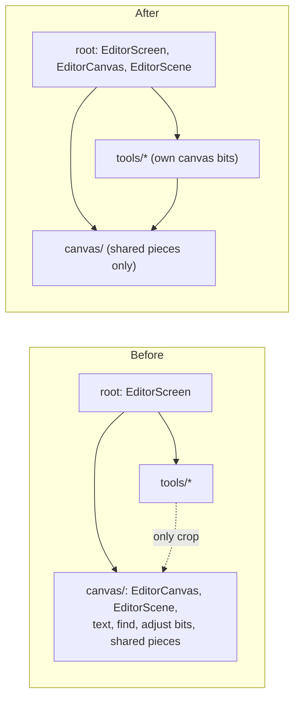

# Tool code out of `canvas/`

A refactoring plan for the editor's `canvas/` folder, written October 2026. `canvas/` holds the canvas pieces every mode shares, and also the code that combines them with each tool. Because of that, the canvas code of Text, Find, and Adjust has to live in `canvas/` too. This plan moves the two composers to the editor root and lets tools import `canvas/`, so each tool keeps its own canvas code. Nothing here changes what the editor shows or does: it's file moves, import rewrites, and lint and doc updates. No component's props change.

## What happens today

Read at `bdb2805`.

`canvas/` has 37 files and about 5,700 lines. Two kinds of code sit there:

1. **Canvas pieces any mode uses**: the viewport and zoom, live transforms, handles, hit testing, snapping, cursors, the selection overlay, and the stroke pipeline that Draw, Redact, and Cut out share.
2. **The composers**: `EditorCanvas.tsx` (669 lines) and `EditorScene.tsx` (226). They call each mode's gesture hook and draw each mode's overlay.

`biome.json` keeps `canvas/` from importing a tool, and keeps every tool except crop from importing `canvas/`. The composers are in `canvas/`, so everything they call has to be in `canvas/` too:

| In `canvas/` | Tool | Used by |
| --- | --- | --- |
| `EditedTextView.tsx` | Text | `EditorScene` |
| `useTextEditGesture.ts` | Text | `EditorCanvas` |
| `useKeepTextFocus.ts` | Text (web only) | `EditorCanvas` |
| `useFindTap.ts` | Find | `EditorCanvas` |
| `DetectionOutline`, `DetectionOverlayRegion`, the `MARKER_*` constants in `SelectionOverlay.tsx` | Find | `EditorScene`, `EditorCanvas`, `useFindTap` |
| `detectionAt` in `hitTest.ts` | Find | `useFindTap` |
| `useDialDragGesture.ts` | Adjust | `EditorCanvas` |
| `LiveAdjustment` in `EditorScene.tsx` | Adjust | `EditorScene`, `EditorCanvas` |

Imports that cross the folder's edge:

* **Into the root**: `canvas/` imports only `TextEditState` from `editorMode.ts`. The two composers and two of the text files use it.
* **Into `shell/`**: `useDialDragGesture` and `canvasInput` import `shell/dialDrag`.
* **From outside**: `EditorScreen.tsx`, `canvasInputFor.ts`, and `tools/crop/` import `canvas/`.

## The change: turn one edge around

The root already composes the other folders (`EditorScreen`, `EditorDock`, `EditorRail`, `EditorInspector`). Once the two composers live there too, a tool may import `canvas/` as `tools/crop/` already does, and `canvas/` imports only `shell/`.

## Decisions

* **The composers go to the editor root, not a new `stage/` folder.** The root's lint rule already lets it import the whole editor. A `stage/` folder would need its own override, which would have to list every ban again, just for two files. The root goes from 17 files to 19.
* **`TextEditState` stays in `editorMode.ts`.** The first draft moved it to `tools/text/` on the grounds that it sat in `editorMode.ts` only for `canvas/`. That isn't so:
  * it's part of the `EditorMode` union (`{ type: "text"; edit: TextEditState }`);
  * the reducer's `startText` and `changeText` actions use it, and `editorMode.test.ts` does too;
  * `tools/text/useTextEditing.ts` already imports it from the root.

  If it moved, `editorMode.ts` and `tools/text/` would import each other. Tools may import the root, so the moved text files keep importing it from there. `TextColorKey` stays as well, since `canvas/` never used it.
* **`layerBounds` stays in `canvas/`.** The draft moved it to `render/` so that Text and Find wouldn't import it from `canvas/`. Once tools may import `canvas/`, that reason is gone. `render/` draws a document for the editor, export, and thumbnails alike. `layerBounds` is editor geometry: the selection outline, the handles, and hit boxes. AGENTS.md lists `canvas/layerBounds.ts` as pure logic only the editor uses. Keeping it also leaves the docs app's `sources.ts` and `AnatomyLesson` as they are.
* **`detectionAt` goes into `tools/find/findResults.ts`, not a new file.** That module already holds what's worked out from Find's regions (`detectionTargetKey`, `chosenBoxes`, `readingOrder`). It's pure, and it has a Node test that can take the cases. `detectionAt` needs only `hitTestBox` from `model/geometry.ts`. It isn't a worklet, so the worklet list in AGENTS.md doesn't change. `hitTest.ts` keeps `findLayerAt`, which the docs app's strokes lesson quotes.
* **`LiveAdjustment` goes into `tools/adjust/useAdjustTool.ts`**, next to `AdjustController`, whose `matrix` it carries. A four-line type doesn't need a file of its own.
* **No `canvas/strokes/` folder.** The stroke pipeline doesn't have clean edges:
  * `useCanvasTap` and `useTextEditGesture` use `strokeIntent`'s `TAP_SLOP_PX`;
  * `useFindTap` uses its `insideDocument`;
  * `useLayerTransformGesture` uses `shapeDrag`'s `dragLineEnd` to drag a line's end.

  The shared core would import from the subfolder. With about 30 files left in `canvas/`, it would only be cosmetic.

## Steps

Each step is its own commit and passes `npm run check`, `npm run typecheck`, and `npm test`. Paths below are under `src/screens/editor/`.

### 1. Move the composers to the root, and let tools import `canvas/`

* `git mv` `canvas/EditorCanvas.tsx` and `canvas/EditorScene.tsx` to the root. Rewrite their imports: `./x` becomes `./canvas/x`, and `../editorMode` becomes `./editorMode`. Update `EditorScreen.tsx`'s import too.
* In `biome.json`, take the three `canvas/` patterns out of the tools override: `../../canvas/**`, `../../../canvas/**`, and `@/screens/editor/canvas/**`. Then the crop override is identical to it, line for line (checked with `diff` at `bdb2805`). Add `src/screens/editor/tools/crop/**` to the tools override's `includes`, delete the crop override, and drop `canvas/` from the message.
* The stickers override comes later in the file and still wins for `tools/stickers/`, so it's unchanged. So are `shell/`, `session/`, and `detection/`.

`refactor: compose the editor canvas at the editor root`

### 2. Move Text's pieces to `tools/text/`

* `git mv` `canvas/EditedTextView.tsx`, `canvas/useTextEditGesture.ts`, and `canvas/useKeepTextFocus.ts` to `tools/text/`.
* Their imports of shared pieces become `../../canvas/x`, and `TextEditState` comes from `../../editorMode`.
* `EditorCanvas` and `EditorScene` import the three from `./tools/text/`.

`refactor: keep the text tool's canvas code with the tool`

### 3. Move Find's pieces to `tools/find/`

* `git mv canvas/useFindTap.ts tools/find/`.
* Move `DetectionOutline`, `DetectionOverlayRegion`, and the four `MARKER_*` constants (with their comment) out of `SelectionOverlay.tsx` into a new `tools/find/DetectionOutline.tsx`. It imports `useScreenPixels` from `../../canvas/SelectionOverlay`.
* Move `detectionAt` from `canvas/hitTest.ts` to `tools/find/findResults.ts`, importing `hitTestBox` by relative `.ts` path like the rest of that file. Move its `describe` block from `canvas/__tests__/hitTest.test.ts` to `tools/find/__tests__/findResults.test.ts`.
* Leave `useFindTool`'s `overlay` type as it is. Typing it with `DetectionOverlayRegion` is possible now, but it's outside this plan.

`refactor: keep the find tool's canvas code with the tool`

### 4. Move Adjust's pieces to `tools/adjust/`

* `git mv canvas/useDialDragGesture.ts tools/adjust/`. It imports only `shell/dialDrag`, which becomes `../../shell/dialDrag`.
* Move `LiveAdjustment` from `EditorScene.tsx` to `useAdjustTool.ts`.

`refactor: keep the adjust tool's canvas code with the tool`

### 5. Narrow the `canvas/` rule, and update AGENTS.md

* **The rule.** After step 4, nothing in `canvas/` imports the root. Ban the root files with single-star patterns: a `*` doesn't cross a `/`, so `../*` matches `../editorMode` but not `../shell/dialDrag` or `../../../model/geometry.ts`. The depth differs between a source file and a test:
  * the `canvas/**` override adds `../*` and `@/screens/editor/*`;
  * that can't cover `canvas/__tests__/`, because a test there imports its module as `../hitTest.ts`, which `../*` matches. Add a `canvas/__tests__/**` override after it, as `shell/__tests__/**` has. It repeats the canvas bans with `../../*` in place of `../*`.

  Don't use `../**` with a `!../shell/**` exception. As AGENTS.md warns, a negation allows more than it looks like it does. Change the message to "canvas/ imports only shell/ from the editor…". Then check that the rule fires:
  * add `import type { EditorMode } from "../editorMode";` to a canvas file, and `../../editorMode.ts` to a canvas test;
  * confirm `npm run lint` fails on both;
  * remove the two imports.
* **AGENTS.md**, in the editor's structure bullet:
  * add `EditorCanvas.tsx` and `EditorScene.tsx` to what the root holds, as what composes the canvas with each tool's gestures and overlays;
  * say `canvas/` holds the canvas pieces every mode shares;
  * replace "`canvas/` imports no tool, `session/`, or `detection/`, and only `tools/crop/` imports `canvas/`" with "`canvas/` imports nothing else from the editor but `shell/`, and tools may import it".

  The learnings name `EditorCanvas` and `EditedTextView` without a folder, so they're still right. The worklet list's `canvas/` files don't move.

`refactor: let canvas/ import only shell/`

### 6. Verify

* Run `npm run build:web`.
* Run `npm run build --prefix docs/interactive`. Nothing it imports moves, so this only confirms that.
* In the web editor, try the paths the moved files serve:
  * text: start a text layer, type, and press on the canvas while typing (the caret should move and the keyboard stay, which is `useKeepTextFocus`); double-tap a text layer to edit it;
  * Find: run it, and tap a found region to choose it, then tap it again;
  * Adjust: a sideways drag on the photo turns the dial;
  * Draw a stroke, and Crop.
* None of the moved files has a `.web` or native counterpart, so the web run covers what changed.

## Result

* `canvas/` goes from 37 files to 30, and imports only `shell/` from the editor.
* The root goes from 17 files to 19.
* `tools/text/` gains three files, `tools/find/` gains two (`useFindTap.ts`, `DetectionOutline.tsx`), and `tools/adjust/` gains one.
* `biome.json` loses the crop override and gains one for `canvas/__tests__/`.

## Not in this plan

* `canvasInput.ts`'s `inputRules` and `outlinedLayerFor` still switch over every mode, and `EditorCanvas` still calls each tool's gesture hook by name. Each tool could export its own rules and gesture, like `TOOL_VIEWS` does for the panels. That changes an API, not just where a file sits, so it's a later step. It's easier after this plan, now that tools may import `canvas/`'s types.
