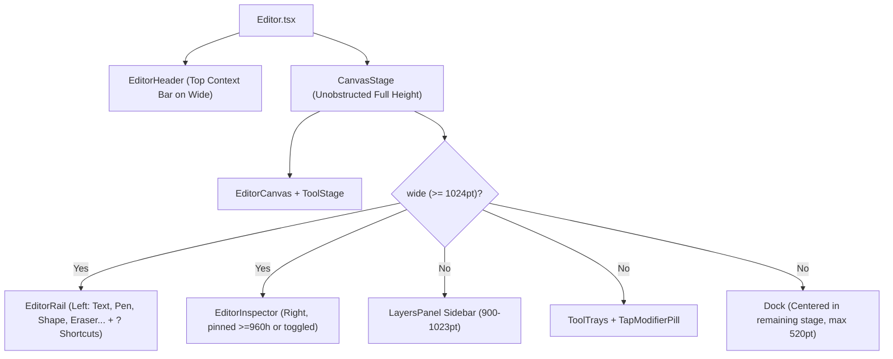

# Editor UI/UX Redesign — Implementation Plan

Companion to [design-plan.md](design-plan.md) (and grounded in [DESIGN.md](../../../DESIGN.md), [docs/architecture.md](../../architecture.md), and [docs/GOTCHAS.md](../../GOTCHAS.md)). This plan translates every surface, tool, commit-semantic, and ergonomic decision into concrete module structures, store/type contracts, gesture/layout mechanics, automated tests, and an ordered sequence of independently shippable commits.

---

## Progress Checklist

- [x] **Step 1: UI Primitives** — Upward/downward popovers, HSV tone helpers, shared color slider, and button trailing icon (`feat(ui): add upward popover placement, HSV tone helpers, and shared color slider`)
- [x] **Step 2: Top Context Bar Polish & Splitting Draw into Pen, Shape, and Eraser Tools** — Refine the anchored top context bar with clean button spacing and unified commit chrome; split `Draw` into top-level `Pen` (`D`), `Shape` (`S`), and `Eraser` (`X`) tools in the rail, dock, and header; implement medium stage centering, keyboard semantics (`Escape` → cancel, `Enter` → done), and pinned layers toggle (`feat(editor): refine top context bar and split draw into pen, shape, and eraser tools`)
- [x] **Step 3: Direct Selection Restyling, Sticker Filtering & `convertShape`** — 1-tap shape and redaction restyling in top bar and phone dock, filter sticker actions (`!layer.sticker`), add `convertShape` (preserving `IdentityLesson.tsx`), and inline strength choices in redaction/find (`feat(editor): add 1-tap shape and redaction restyling and filter sticker actions`)
- [x] **Step 4: Cut Tool Commit Semantics (`Keep only ✓`), Re-Editing Cutouts & Floating `Tap` Modifier Pill** (`feat(cut): commit selection with Keep only, support restoring cutouts, and float Tap modifiers`)
- [x] **Step 5: Text Tool Ergonomics — 1-Tap Cycling Align & Inline Dock Color** (`feat(text): replace Align tab with 1-tap cycle button and swap custom color inline in dock`)
- [x] **Step 6: Crop Flattening & Stage Polish** (`feat(crop,adjust,find): flatten wide Crop, size stage dynamically, and opaque-surface readouts`)
- [x] **Step 7: Rail Tool Groups & Subtool Flyouts** (`feat(rail): add tool group corner markers and right-click/long-press subtool flyouts for Pen, Shape, and Cut`)
- [x] **Step 8: Docs & Final Polish** (`docs: sync architecture and design docs with top bar and split tools`)

---

## 1. Guiding Engineering Mandates

### 1.1 Structural Freedom: Let the Cleaner Architecture Emerge
Do **not** force awkward compromises onto legacy structures. When an area reveals a simpler boundary, restructure files, types, hooks, and components freely (within the one-way import graph in [docs/architecture.md](../../architecture.md)):

1. **Keep Tool Options Anchored in the Top Bar on Desktop:** Keep wide tool configurations in `ContextBar.tsx` mounted inside `EditorHeader.tsx`. This keeps the light table canvas completely open from edge to edge without a floating card covering the bottom of the photo.
2. **Flatten 3-Level Nesting by Splitting Complex Tools:** Split `Draw` (which previously nested Draw → Brush → 4 tips, or Draw → Shape → 4 shapes, or Draw → Eraser) into three distinct, first-class top-level tools:
   - **`Pen` (`D`):** Freehand drawing strokes (Pen, Highlighter, Marker, Neon) + Color + Size.
   - **`Shape` (`S`):** Vector geometric shapes (Rectangle, Ellipse, Line, Arrow) + Stroke width presets (thin, medium, thick) + Color.
   - **`Eraser` (`X`):** Eraser for drawings and shapes + Size.
   Every tool now has a 1-level flat configuration row in the top bar and phone dock.
3. **Decouple Idle Restyling from In-Place Editing on `ToolDefinition`:** Currently `edit` on `textTool` conflates two orthogonal behaviors: *"tap/Enter on a selected layer opens an interactive draft editor"* (`Text`) and *"selecting this layer in idle mode shows this tool's style controls"* (`Text`, `Shape`, `Redaction`). Split `stylesLayer?: (layer: Layer) => boolean` from `edit?: { owns; start }` so `shapeTool` and `redactTool` restyle selected shapes and redactions directly in 1 tap without claiming interactive draft-edit mode.
4. **Deduplicate Repeated Hooks and UI Slider Primitives:**
   - Extract `useColorTarget` into `src/editor/shell/useColorTarget.ts`.
   - Reuse `useNormalizedDrag` / `GradientSlider` from Step 1 for 1D hue and tone sliders.
5. **Keep `docs/architecture.md` and `DESIGN.md` in Sync:** Update both whenever module responsibilities or shell components move.

### 1.2 Aggressive Comment Hygiene
Every file touched by this plan must undergo a deliberate comment cleanup pass:
- **Follow the `AGENTS.md` docblock rule strictly:** *"A doc comment longer than a short paragraph is a sentence on what it is, then a short list, one line per behavior or parameter."*
- **Delete prose essays and redundant restatements:** Remove multi-paragraph narrative comments that restate TypeScript types, JSX hierarchy, or obvious prop names.
- **Delete archaeological comments:** Remove notes explaining why old designs existed.
- **Preserve load-bearing non-obvious invariants concisely:** Keep 1–2 line comments for platform traps, Skia constraints, gesture/worklet ordering, and race guards documented in `AGENTS.md` and `docs/GOTCHAS.md`.

### 1.3 Non-Negotiable Architecture & Design Guardrails
- **Import flow (`docs/architecture.md`):** `app` → `screens` → `editor` → `ui` → `platform`. `editor/document/` and lowercase `.ts` files in `editor/layers/` stay pure TypeScript (no React, React Native, or Skia). `editor/render/` and layer views never read the store. Tools never import each other; only `builtInSpecs.ts` and `builtInTools.ts` import tools.
- **Interactive docs compatibility (`docs/interactive`):**
   `docs/interactive/src/lessons/model/IdentityLesson.tsx` imports `restyleShape` from `src/editor/layers/shape/shape.ts` and explicitly asserts that `restyleShape(rectangle, { shape: "arrow" })` returns the **same object reference**. **Keep `restyleShape` unchanged**; add sibling pure helper `convertShape(layer: ShapeLayer, patch: ShapeEdit): ShapeLayer` for cross-geometry conversion.
- **Design rules (`DESIGN.md`):**
  - *One Marker Rule:* `colors.accent` (`#FFE433`) appears **only** via `<Highlight />`. Primary commit buttons (`Keep only ✓`, `Redact N ✓`) use `colors.primary` fill + `colors.onPrimary` label and glyph.
  - *Off-Limits Photo Rule:* Floating modifier pills and readouts use opaque `colors.surface` + `1pt` `colors.borderStrong` + `floatingShadow` — never `colors.scrim` or translucent glass.
  - *No Gray Label Rule:* Interactive labels use `colors.textPrimary`, never `colors.textSecondary`.

---

## 2. Target Architecture & Cross-Cutting Mechanics



### 2.1 Refined Top Context Bar (`ContextBar.tsx`)
- Anchored inside `EditorHeader` when wide and a tool is active or a layer is selected.
- Clean button sizing: dedicated `BarActionButton` for Cancel (`✕`) and Done (`✓` / `Keep only ✓` / `Deselect`) with clean circular target (32×32pt / 36×36pt) and zero negative touch halo margins.
- `styles.controls` has `flexShrink: 0` and divider has 10px margins, preventing any crowding or visual overlapping.
- Popovers drop downward naturally over the light table with 160ms ease.

### 2.2 Medium Breakpoint (`900–1023pt`) Stage-Centered Dock
- Pass `rightInset = layersBeside && layersOpen ? LAYERS_SIDEBAR_INSET : 0` to `Dock` and `ToolTrays`.
- `Dock`'s outer centering wrapper applies `paddingRight: rightInset`, centering the `maxWidth: 520` dock cleanly within the remaining canvas stage.
- Update `Tray` in `src/editor/shell/ToolOptions.tsx` to accept `rightInset` and apply `paddingRight: rightInset` to `styles.trayArea`.
- In `HeaderActions`, enable the `Layers` toggle when `(!tool || layersBeside)` so medium screens can toggle the sidebar during active tools.

### 2.3 Unified Session Chrome & Keyboard Semantics (`Escape` vs `Enter`)

| State | Left / Secondary Actions | Primary Right Action | `Escape` Key | `Enter` / `⌘+Enter` Key |
| :--- | :--- | :--- | :--- | :--- |
| **Idle, layer selected** | Tool / style controls | `Deselect` (`TextButton`, `colors.textPrimary`) | Deselects layer | Opens in-place editor (`Text`) |
| **Live tool (`Pen`, `Shape`, `Eraser`, `Redact`, `Find`)** | `[Reset]` (if any), `✕ Cancel` | `✓ Done` (or `Redact N ✓` primary in `Find`) | `✕ Cancel` (`cancel`) | `✓ Done` (`done`) |
| **Session tool (`Adjust`, `Crop`)** | `[Reset]` (when dirty), `✕ Cancel` | `✓ Done` | `✕ Cancel` (`cancel`) | `✓ Done` (`done`) |
| **`Cut` (nothing selected, uncut)** | `✕ Cancel` | *(omitted)* | `✕ Cancel` (`cancel`) | *(no-op)* |
| **`Cut` (selection active / re-editing)** | `[Reset]`, `✕ Cancel` | `Keep only ✓` (or `Restore photo ✓`, primary button) | `✕ Cancel` (`cancel`) | Runs primary commit (`done`) |
| **`Text` (typing)** | `✕ Cancel` | `✓ Done` | `✕ Cancel` (`cancel`) | `⌘+Enter` / `Ctrl+Enter` commits; `Enter` inserts `\n` |

- **Tap-away on canvas (`onTapAway`):** Tapping empty light-table space outside the photo/layer calls `done` (committing live edits naturally on touch devices, or canceling `Cut` only when nothing is selected), while `✕` and `Escape` always revert via `cancel`.
- **Protecting Draft States with `inert`:** Add `inert?: boolean` support to `LayersPanel.tsx` (using `toggleAttribute("inert", inert)` on web ref, `pointerEvents={inert ? "none" : "auto"}` on native). Pass `inert={draftOpen}` to `LayersPanel` in `Editor.tsx`.

---

## 3. Ordered Implementation Steps

---

### Step 1: UI Primitives — Upward/Downward Popovers, HSV Tone Math, Shared Slider Drag
**Commit:** `feat(ui): add upward popover placement, HSV tone helpers, and shared color slider` (COMPLETED in `4c31587`)

---

### Step 2: Top Context Bar Polish & Splitting Draw into Pen, Shape, and Eraser Tools
**Commit:** `feat(editor): refine top context bar and split draw into pen, shape, and eraser tools`

#### Files to Create / Modify
- `src/editor/shell/ContextBar.tsx` (clean horizontal row, dedicated `BarActionButton` with zero negative margins, clean divider spacing)
- `src/editor/EditorHeader.tsx` & `src/ui/ScreenHeader.tsx` (ensure smooth bar swap, clean title and commit chrome)
- `src/editor/shell/HeaderActions.tsx` (remove redundant `onReset`; enable `layers` toggle when `!inspectorPinned && (!tool || layersBeside)`; add `onShortcuts` `?` button)
- `src/editor/EditorRail.tsx` (add `Pen`, `Shape`, `Eraser` at top level; add `?` shortcuts button in rail footer)
- `src/editor/shell/Dock.tsx` (add `rightInset` stage-centering on `900–1023pt`; clean `onReset` + `Deselect` + primary `done` button support in `DockFooter`)
- `src/editor/shell/ToolOptions.tsx` (`Tray` accepts `rightInset`)
- `src/editor/layers/panel/LayersPanel.tsx` (support `inert?: boolean`)
- Split Draw into 3 tools:
  - Create `src/editor/tools/pen/` (`penTool.ts`, `penSpec.ts`, `usePenTool.ts`, `PenPanel.tsx`, `penSettings.ts`)
  - Create `src/editor/tools/shape/` (`shapeTool.ts`, `shapeSpec.ts`, `useShapeTool.ts`, `ShapePanel.tsx`)
  - Create `src/editor/tools/eraser/` (`eraserTool.ts`, `eraserSpec.ts`, `useEraserTool.ts`, `EraserPanel.tsx`)
- Update `builtInSpecs.ts`, `builtInTools.ts`, `Editor.tsx`
- Keyboard semantics: `Escape` → cancel, `Enter` / `mod+Enter` → done in `useEditorShortcuts.ts` and `editorMode.ts`
- Tests: `editorChrome.test.ts`, `editorFrame.test.ts`, `editorMode.test.ts`, `shortcuts.test.ts`, `defineTool.test.ts`

#### Technical Details
1. **Refined Top Context Bar (`ContextBar.tsx`):**
   - Housed inside `EditorHeader`.
   - `BarActionButton` renders Cancel (`close-outline`, shortcut Escape) and Done (`checkmark-outline` / `Keep only ✓` / `Deselect`).
   - Clean 32×32pt / 36×36pt circular button without negative margins, avoiding all overlap.
   - `controls` has `flexShrink: 0` so child segments never squeeze or overflow.
2. **Three First-Class Tools:**
   - **`Pen` (`D`):**
     - Spec: label `"Pen"`, icon `"draw"`, shortcut `"D"`.
     - Controls: Tip selector chip/popover (`Pen`, `Highlighter`, `Marker`, `Neon`) | `ColorChip` | `SizeChip`.
     - Dock: `[Pen ▾] [Highlighter ▾] [Marker ▾] [Neon ▾] [Style]`.
   - **`Shape` (`S`):**
     - Spec: label `"Shape"`, icon `"shape-outline"`, shortcut `"S"`.
     - Controls: `[Rectangle | Ellipse | Line | Arrow]` segments | 3 stroke preset dots (`thin`, `medium`, `thick`) | `ColorChip`.
     - Dock: Row 1 has `[Rectangle | Ellipse | Line | Arrow]` + 3 stroke dots; Row 2 has `ColorSwatches`.
   - **`Eraser` (`X`):**
     - Spec: label `"Eraser"`, icon `"eraser"`, shortcut `"X"`.
     - Controls: Size preset dots / `SizeChip`.
     - Dock: Size choices.
3. **Session Chrome & Medium Centering:**
   - On `900–1023pt`, `Dock` centers cleanly with `paddingRight: rightInset`.
   - Header allows toggling layers sidebar during live tools on medium screens.
   - `inert={draftOpen}` applied to `LayersPanel`.

---

### Step 3: Direct Selection Restyling, Sticker Filtering & `convertShape`
**Commit:** `feat(editor): add 1-tap shape and redaction restyling and filter sticker actions`

#### Files to Create / Modify
- `src/editor/layers/shape/shape.ts`, `src/editor/layers/shape/shapeEdits.ts`, `src/editor/layers/shape/__tests__/shape.test.ts`
- `src/editor/store/editorSlice.ts` & `src/editor/store/__tests__/editorSlice.test.ts`
- `src/editor/defineTool.ts`, `src/editor/useEditorTools.ts`, `src/editor/editorChrome.ts`
- `src/editor/shell/useColorTarget.ts`
- `src/editor/shell/redactStyle.tsx`, `src/editor/tools/redact/RedactPanel.tsx`, `src/editor/tools/redact/redactTool.ts`
- `src/editor/LayerSelectionBar.tsx`, `src/editor/document/framing.ts`, `src/editor/document/__tests__/framing.test.ts`
- `src/editor/tools/find/findSpec.ts`, `src/editor/tools/cut/cutSpec.ts`, `src/editor/tools/cut/removeBgSpec.ts`, `src/editor/tools/redact/redactSpec.ts`

#### Technical Details
1. **`convertShape` in `shape.ts`:**
   - Keep `restyleShape` untouched for `IdentityLesson.tsx`.
   - Add `convertShape(layer: ShapeLayer, patch: ShapeEdit): ShapeLayer` for seamless Box ↔ Line conversion preserving id, transform, color, strokeWidth, hidden, and locked.
   - Wire `setShapeStyle` to use `convertShape`.
2. **Direct Selection Styling (`stylesLayer`):**
   - Add `stylesLayer?: (layer: Layer) => boolean` to `ToolDefinition`.
   - When a Shape layer is selected, `shapeTool`'s bar renders directly in the top bar (and dock on phone) with `Deselect`.
   - When a Redaction layer is selected, `redactTool`'s bar renders `[Solid | Blur | Pixelate]` + Color/Strength + `Deselect`.
3. **Sticker Filtering:**
   - Filter `!layer.sticker` in `findSpec`, `cutSpec`, `removeBgSpec`, and `redactSpec`.
   - Update `targetImageLayer` to ignore stickers.
   - Update `LayerSelectionBar` to hide `[Free resize]` on stickers.
   - Resolve `defaultImage` in `startTool` so `starters.adjust()` targets the selected sticker.
4. **Inline Strength Choices:**
   - Surface 1-tap `StrengthChoices` in `redactLookItems` when `effect !== "solid"`, making strength 1 tap away in active Redact and Find modes.

---

### Step 4: Cut Tool Commit Semantics (`Keep only ✓`), Re-Editing Cutouts & Floating `Tap` Modifier Pill
**Commit:** `feat(cut): commit selection with Keep only, support restoring cutouts, and float Tap modifiers`

*(Fixes [Issue #15](https://github.com/nverkhachoyan/tuck/issues/15))*

#### Files to Modify
- `src/editor/tools/cut/useCutTool.ts` & `src/editor/tools/cut/useCutOut.ts`
- `src/editor/tools/cut/CutPanel.tsx` & `src/editor/tools/cut/cutTool.ts`
- `src/editor/layers/image/__tests__/mask.test.ts` & `src/editor/__tests__/editorChrome.test.ts`

#### Technical Details
1. **Fixing the Commit Paradox:**
   - Case A (Uncut photo, nothing selected): `done` omitted; shows `✕ Cancel` only.
   - Case B (Active selection): `done` runs `keepOnly`, commit button says `[Keep only ✓]` (`variant: "primary"`), toast offers `Refine`.
   - Case C (Re-editing cutout + Reset): commits restored uncut photo (`[Restore photo ✓]`).
2. **Stable 6-Button Phone Row (#15):**
   - `[Subjects] [Tap] [Add ▾] [Subtract ▾] [Invert] [Actions ▾]`.
3. **Opaque Floating `Tap` Modifier Pill:**
   - `[+ Adds | − Subtracts]` + `[− Smaller | + Larger]` on opaque `Surface` paper 8pt above Dock / Canvas.

---

### Step 5: Text Tool 1-Tap Cycling `Align` & Inline `100pt` Dock Color Swap
**Commit:** `feat(text): replace Align tab with 1-tap cycle button and swap custom color inline in dock`

#### Files to Modify
- `src/editor/tools/text/TextStylePanel.tsx`
- `src/editor/tools/text/textTool.ts` & `src/editor/tools/text/useTextTool.ts`

#### Technical Details
1. **1-Tap Cycling `Align` Button:**
   - Remove `"align"` from tabs; pin cycling button at end of tab strip and inline in top bar. Cycles `left → center → right → left`.
2. **Inline `100pt` Dock Color Swap:**
   - Remove `TextColorResults`.
   - Swap `100pt` dock in place to `InlineTextColorPicker` (Back, Eyedropper, static Hex, Hue bar, Tone bar) so keyboard stays up.

---

### Step 6: Crop Tool Wide Flattening, Dynamic Stage Height & Adjust/Find Polish
**Commit:** `feat(crop,adjust,find): flatten wide Crop, size stage dynamically, and opaque-surface readouts`

#### Files to Modify
- `src/editor/tools/crop/CropPanel.tsx` & `src/editor/tools/crop/cropTool.ts`
- `src/editor/tools/adjust/AdjustPanel.tsx` & `src/editor/tools/adjust/adjustTool.ts`
- `src/editor/tools/find/FindPanel.tsx` & `src/editor/tools/find/findTool.ts`

#### Technical Details
1. **Flatten Wide Crop:**
   - `CropBar` provides horizontal controls in top bar without empty dial wells.
2. **Adjust & Find Polish:**
   - Opaque `Surface` for `ChangingValue` floating readout.
   - Consolidate Find status and review steppers.

---

### Step 7: Rail Tool Groups & Subtool Flyouts
**Commit:** `feat(rail): add tool group corner markers and right-click/long-press subtool flyouts for Pen, Shape, and Cut`

#### Files to Modify
- `src/editor/shell/ToolButton.tsx` (add optional corner flyout indicator `flyout?: boolean`, right-click `onContextMenu`, and long-press handler)
- `src/editor/EditorRail.tsx` & `src/editor/shell/ToolsPanel.tsx` (wire group popovers with `placement="right"`)
- `src/editor/shell/toolList.ts` (tool group configuration: Pen tips, Shape kinds, Cut / Remove BG)
- `src/editor/tools/pen/`, `src/editor/tools/shape/`, `src/editor/tools/cut/` (update rail icon to reflect active variant)

#### Technical Details
1. **Corner Flyout Indicator:**
   - Small `◢` corner marker in the bottom-right corner of the icon tile.
   - Drawn in `colors.textTertiary`, switching to `colors.onHighlight` when selected.
2. **Desktop / Web Interaction:**
   - Left-click activates tool with its current variant.
   - Right-click (`onContextMenu`) or click-and-hold opens a popover adjacent to the rail (`placement="right"`).
   - Selecting a variant switches to it, updates the rail icon, and starts the tool.
3. **Touch / Mobile Interaction:**
   - Long-press triggers light haptic tick (`Haptics.impactAsync`) and opens the variant popover/tray.
   - Tapping an already active tool button opens its variant selector.

---

### Step 8: Comment Audit, Architecture & Design Docs Sync, Interactive Docs Check & Full Verification
**Commit:** `docs: sync architecture and design docs with top bar and split tools`

#### Files to Modify
- `docs/architecture.md`
- `DESIGN.md`
- `docs/plans/follow-ups-plan.md`
- Final comment sweep (1-sentence + 1-line-per-bullet rule).

---

## 4. Verification Plan

### 4.1 Automated Checks (Run After Every Step)
```bash
pnpm check
pnpm typecheck
pnpm test
pnpm build:web
pnpm --dir docs/interactive build
```

### 4.2 Interactive Viewport, Palette & Input Matrix
- **Phone (`375 × 812pt`)**: Cut 6-button dock; Pen / Shape / Eraser 1-tap tools; Text cycling Align; 1-tap layer restyling.
- **Medium (`950 × 800pt`)**: Layers sidebar toggle during active tools; Dock centered cleanly with `rightInset`.
- **Wide (`1280 × 800pt` & `1440 × 980pt`)**: Top `ContextBar` active with zero canvas obstruction; 1-level flat controls; `Escape` cancels, `Enter` commits; `?` opens shortcuts.
- **iPad Pro (`1024 × 1366pt`)**: Coarse touch density; clean top bar; natural popover placement.
