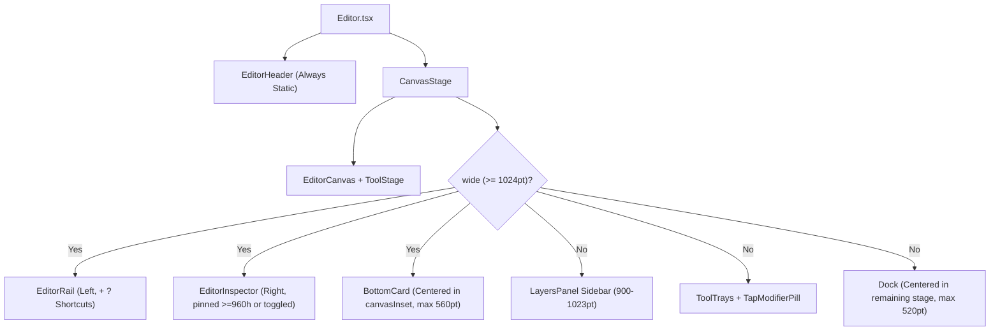

# Editor UI/UX Redesign — Implementation Plan

Companion to [design-plan.md](design-plan.md) (and grounded in [DESIGN.md](../../../DESIGN.md), [docs/architecture.md](../../architecture.md), and [docs/GOTCHAS.md](../../GOTCHAS.md)). This plan translates every surface, tool, commit-semantic, and ergonomic decision in the design plan into concrete module structures, store/type contracts, gesture/layout mechanics, automated tests, and an ordered sequence of independently shippable commits.

---

## Progress Checklist

- [x] **Step 1: UI Primitives** — Upward popover placement, HSV tone helpers, shared color slider, and button trailing icon (`feat(ui): add upward popover placement, HSV tone helpers, and shared color slider`)
- [ ] **Step 2: Bottom Card & Static Header** — Unify wide tools into floating bottom card, static header, medium stage centering, and keyboard semantics (`feat(editor): unify wide tools into floating bottom card and keep header static`)
- [ ] **Step 3: Direct Selection Restyling** — 1-tap shape & redaction restyling, sticker filtering, and `convertShape` (`feat(editor): add 1-tap shape and redaction restyling and filter sticker actions`)
- [ ] **Step 4: Cut Tool Semantics** — Commit selection with `Keep only ✓`, re-edit cutouts, and floating `Tap` modifier pill (`feat(cut): commit selection with Keep only, support restoring cutouts, and float Tap modifiers`)
- [ ] **Step 5: Draw Phone Ergonomics** — First-class `Pen` & `Highlighter`, `▾` sub-tool chevrons, and composite `Style` badge (`feat(draw): split Pen and Highlighter in phone dock and show tip size on Style`)
- [ ] **Step 6: Text Tool Ergonomics** — 1-tap cycling `Align` button and inline 100pt dock color swap (`feat(text): replace Align tab with 1-tap cycle button and swap custom color inline in dock`)
- [ ] **Step 7: Crop Flattening & Stage Polish** — Flatten wide `CropCard`, dynamic stage height, and opaque-surface readouts (`feat(crop,adjust,find): flatten wide Crop card, size stage dynamically, and opaque-surface readouts`)
- [ ] **Step 8: Docs & Final Polish** — Sync architecture/design docs, audit comments, and verify interactive lessons (`docs: sync architecture and design docs with unified bottom card shell`)

---

## 1. Guiding Engineering Mandates

### 1.1 Structural Freedom: Let the Cleaner Architecture Emerge
Do **not** bolt new UI states onto legacy abstractions that only existed for the split Header `ContextBar` + bottom `ToolCard` era. Whenever touching an area reveals a simpler boundary, restructure files, types, hooks, and components freely (within the one-way import graph in [docs/architecture.md](../../architecture.md)):

1. **Retire `ContextBar` completely:** Delete `src/editor/shell/ContextBar.tsx` and remove the `bar` prop from `EditorHeader.tsx` and `ui/ScreenHeader.tsx` (no screen outside the editor uses `ScreenHeader.bar`). Move reusable horizontal controls (`OptionSegments`, `BarChip`, `BarButton`, `BarGroup`, `BarSections`, `keepFocus`) into `src/editor/shell/CardControls.tsx` alongside a unified `src/editor/shell/BottomCard.tsx`.
2. **Collapse `views.Bar` + `views.Card` into one wide slot (`views.Card`):** `ToolViews<C>` drops `Bar` altogether. Every tool that renders controls on wide screens (`≥ 1024pt`) provides a single `Card` view rendered inside `BottomCard`, which owns session chrome (`Reset`, `✕ Cancel`, `Keep only ✓` / `✓ Done` / `Deselect`), `keepFocus`, upward popover placement, and pointer/touch density.
3. **Decouple idle restyling from in-place editing on `ToolDefinition`:** Currently `edit` on `textTool` conflates two orthogonal behaviors: *"tap/Enter on a selected layer opens an interactive draft editor"* (`Text`) and *"selecting this layer in idle mode shows this tool's style controls"* (`Text`, `Shape`, `Redaction`). Split `stylesLayer?: (layer: Layer) => boolean` from `edit?: { owns; start }` so `drawTool` and `redactTool` restyle selected shapes and redactions in 1 tap without claiming interactive draft-edit mode.
4. **Share style sub-views between active tool mode and idle layer selection:** Extract `ShapeStyleControls` (used by `DrawPanel` and idle shape selection) and `RedactStyleControls` (used by `RedactPanel`, `FindPanel`, and idle redaction selection) so phone docks and wide bottom cards never duplicate swatch/strength/kind wiring.
5. **Deduplicate repeated hooks and UI slider primitives:**
   - Extract `useColorTarget` (duplicated identically in `DrawPanel.tsx` and `TextStylePanel.tsx`) into `src/editor/shell/useColorTarget.ts`.
   - Extract the 1D pan gesture + layout measurement in `src/ui/ColorPicker.tsx` into a shared `useNormalizedDrag` / `GradientSlider` helper so `ColorPicker` (2D field + hue bar) and `InlineColorPicker` (100pt hue + tone bars for phone `Text`) share one tested gesture path.
6. **Keep `docs/architecture.md` and `DESIGN.md` in sync:** Update both whenever module responsibilities or shell components move.

### 1.2 Aggressive Comment Hygiene
Every file touched by this plan must undergo a deliberate comment cleanup pass:

- **Follow the `AGENTS.md` docblock rule strictly:** *"A doc comment longer than a short paragraph is a sentence on what it is, then a short list, one line per behavior or parameter."*
- **Delete prose essays and redundant restatements:** Remove multi-paragraph narrative comments that restate TypeScript types, JSX hierarchy, or obvious prop names (heavy offenders today include `Editor.tsx`, `PanelViews.tsx`, `ContextBar.tsx`, `Dock.tsx`, `editorChrome.ts`, `useCutTool.ts`, `useCutOut.ts`, `CutPanel.tsx`, `CropPanel.tsx`, `TextStylePanel.tsx`, `AdjustPanel.tsx`, and `FindPanel.tsx`).
- **Delete archaeological comments:** Remove notes explaining why old designs existed (e.g., why `ContextBar` lived in `ScreenHeader`, why `Cut` `done` used to cancel, why `CropControls` kept a `100pt` well).
- **Preserve load-bearing non-obvious invariants concisely:** Keep 1–2 line comments for platform traps, Skia constraints, gesture/worklet ordering, and race guards documented in `AGENTS.md` and `docs/GOTCHAS.md` (e.g., `Platform.OS === "web"` vs `window`, transparent-gradient gray midpoint, iOS `Pan.minDistance(0)` `onFinalize`, freed `SkImage` cache lifetimes, RNGH tag-1 frame stability).

### 1.3 Non-Negotiable Architecture & Design Guardrails
- **Import flow (`docs/architecture.md`):** `app` → `screens` → `editor` → `ui` → `platform`. `editor/document/` and lowercase `.ts` files in `editor/layers/` stay pure TypeScript (no React, React Native, or Skia). `editor/render/` and layer views never read the store. Tools never import each other; only `builtInSpecs.ts` and `builtInTools.ts` import tools.
- **Interactive docs compatibility (`docs/interactive`):**
  - `docs/interactive/src/lessons/model/IdentityLesson.tsx` imports `restyleShape` from `src/editor/layers/shape/shape.ts` and explicitly asserts that `restyleShape(rectangle, { shape: "arrow" })` returns the **same object reference** because `BoxShape` and `LineShape` have distinct geometry fields. **Keep `restyleShape` unchanged**; add a sibling pure helper `convertShape(layer: ShapeLayer, kind: ShapeKind): ShapeLayer` for cross-geometry conversion (`rectangle`/`ellipse` ↔ `line`/`arrow`).
  - `FramingLesson.tsx` imports `cropGeometry.ts`; keep its exports intact.
- **Design rules (`DESIGN.md`):**
  - *One Marker Rule:* `colors.accent` (`#FFE433`) appears **only** via `<Highlight />`. Primary commit buttons (`Keep only ✓`, `Redact N ✓`) use `colors.primary` fill + `colors.onPrimary` label and glyph (`#000000` / `#FFFFFF` by day, `#F3F3F1` / `#000000` at night).
  - *Off-Limits Photo Rule:* Every floating card, modifier pill, and readout (`BottomCard`, Cut's `Tap` modifier pill, Adjust's `ChangingValue`) uses opaque `colors.surface` + `1pt` `colors.borderStrong` + `floatingShadow` — never `colors.scrim` or translucent glass.
  - *No Gray Label Rule:* Interactive labels (`Deselect`, `Reset`, `Actions ▾`, segments, chips) use `colors.textPrimary` (`ink` / `graphite-ink`), never `colors.textSecondary`.

---

## 2. Target Architecture & Cross-Cutting Mechanics



### 2.1 Deterministic Bottom Card Height (Avoiding the `GOTCHAS.md` Tag-1 Bug)
[docs/GOTCHAS.md](../../GOTCHAS.md) records that measuring a wide bottom card via `onLayout` → `setState` changes `frame` a commit *after* a tool opens, rebuilding `EditorCanvas`'s `Gesture.Simultaneous` while RNGH's legacy `GestureDetector` still has a pending microtask (`"No handler for tag 1"` in hidden web panes) and shifting the photo whenever status text wraps.

To get exact per-tool stage insets (`design-plan.md` §3.2–§3.3) **without** post-open layout jumps:
- Give each wide card a deterministic row/kind descriptor on `ToolDefinition` (or computed synchronously from `(controller, compactControls)`):
  - `'none'`: `0pt` (`Stickers`, idle with no selection).
  - `'single'`: `48pt` fine / `56pt` coarse (`Draw`, `Redact`, `Text`, `Crop` without photo, idle selection styling/actions).
  - `'double'`: `88pt` fine / `96pt` coarse (`Adjust`, `Crop` with photo, `Cut`, idle `Shape` 2-row card if stacked or `single` when inline).
  - `'find'`: `132pt` fine / `144pt` coarse (`Find` 2-row card with status + steppers).
- In `FindPanel.tsx`, enforce `numberOfLines={1}` (`ellipsizeMode="tail"`) on status text so wrapping never violates deterministic height.
- In `BottomCard.tsx`, set `flexWrap: "nowrap"` and allow width to expand up to `Math.min(680, windowWidth - inset.left - inset.right - 32)` on coarse touch devices so `CropCard` Row 1 fits comfortably without clipping or wrapping.
- Compute vertical card offset synchronously in `editorFrame.ts` / `useEditorLayout.ts`:
  - `cardBottom = Math.max(16, safeAreaBottom + 8)` (`16pt` desktop, `42pt` on iPad with `34pt` home indicator).
  - `coveredBottom = cardHeight > 0 ? cardBottom + cardHeight + 16 : 0`.
- `canvasInset.bottom` lands on its exact value on the **very first render** of tool open/close. `EditorCanvas` and `CropCanvas` fit once, never jump, and never rebuild gestures mid-open.

### 2.2 Medium Breakpoint (`900–1023pt`) Stage-Centered Dock
In `editorFrame.ts`, `900–1023pt` sets `wide = false` and `layersBeside = true`. Currently `Dock.tsx` stretches `left: 0, right: 0` across the full window, so an open `340pt` `Layers` sidebar overlaps or off-centers the `520pt` dock.
- Pass `rightInset = layersBeside && layersOpen ? LAYERS_SIDEBAR_INSET : 0` to `Dock` and `ToolTrays`.
- `Dock`'s outer centering wrapper applies `paddingRight: rightInset`, centering the `maxWidth: 520` dock cleanly within the remaining canvas stage.
- Update `Tray` in `src/editor/shell/ToolOptions.tsx` to accept `rightInset` and apply `paddingRight: rightInset` to `styles.trayArea`, preventing contextual option trays (`BrushOptions`, `RedactOptions`, `CutOptions`, `FindOptions`) from overlapping the sidebar.
- In `HeaderActions`, enable the `Layers` toggle when `(!tool || layersBeside)` so medium screens can toggle the sidebar during active tools.

### 2.3 Upward Popovers & `160ms` Motion
- Extend `PopoverPlacement` in `src/ui/popoverPlacement.ts` from `"below" | "beside"` to `"below" | "above" | "beside"`:
  - For `"above"`, place `y = anchor.y - POPOVER_GAP - card.height`; fall back to `anchor.y + anchor.height + POPOVER_GAP` only if `y < POPOVER_MARGIN`, then clamp within `[POPOVER_MARGIN, viewport.height - POPOVER_MARGIN - card.height]`.
  - For horizontal placement with `"above"`, center the popover over the trigger chip: `clamp(anchor.x + (anchor.width - card.width) / 2, card.width, viewport.width)`.
- Export `PopoverPlacementContext = createContext<PopoverPlacement>("below")` from a dedicated pure file `src/ui/popoverContext.ts` (imported by `Popover.tsx`, `Popover.web.tsx`, and `CardChip`), strictly avoiding Metro `.web.tsx` circular resolution per `AGENTS.md`.
- Add a `160ms` `cubic-bezier(0.2, 0, 0, 1)` entrance transition (opacity + subtle `4pt` translate toward anchor) in `Popover.web.tsx` and `Popover.tsx`, gated on `position !== undefined` (to prevent an initial measuring flash at `(0, 0)`) and reduced-motion (`prefers-reduced-motion: reduce` on web, `useReducedMotion()` from Reanimated on native).

### 2.4 Unified Session Chrome & Keyboard Semantics (`Escape` vs `Enter`)
Today `editorMode.ts` and `useEditorShortcuts.ts` bind `Escape` to `done` (`doneWithTool`), contradicting `design-plan.md` §9.4. Align keyboard and button chrome across all tools:

| State | Left / Secondary Actions | Primary Right Action | `Escape` Key | `Enter` / `⌘+Enter` Key |
| :--- | :--- | :--- | :--- | :--- |
| **Idle, layer selected** | Tool / style controls | `Deselect` (`TextButton`, `colors.textPrimary`) | Deselects layer | Opens in-place editor (`Text`) |
| **Live tool (`Draw`, `Redact`, `Find`)** | `[Reset]` (if any), `✕ Cancel` | `✓ Done` (or `Redact N ✓` primary in `Find`) | `✕ Cancel` (`cancel`) | `✓ Done` (`done`) |
| **Session tool (`Adjust`, `Crop`)** | `[Reset]` (when dirty), `✕ Cancel` | `✓ Done` | `✕ Cancel` (`cancel`) | `✓ Done` (`done`) |
| **`Cut` (nothing selected, uncut)** | `✕ Cancel` | *(omitted)* | `✕ Cancel` (`cancel`) | *(no-op)* |
| **`Cut` (selection active / re-editing)** | `[Reset]`, `✕ Cancel` | `Keep only ✓` (or `Restore photo ✓`, primary button) | `✕ Cancel` (`cancel`) | Runs primary commit (`done`) |
| **`Text` (typing)** | `✕ Cancel` | `✓ Done` | `✕ Cancel` (`cancel`) | `⌘+Enter` / `Ctrl+Enter` commits; `Enter` inserts `\n` |

> **Tap-away on canvas (`onTapAway`):** Tapping empty light-table space outside the photo/layer continues to call `done` (committing live edits naturally on touch devices, or canceling `Cut` only when nothing is selected), while `✕` and `Escape` always revert via `cancel`.
>
> **Protecting Draft States with `inert`:** Add `inert?: boolean` support to `LayersPanel.tsx` (using `toggleAttribute("inert", inert)` on web ref, `pointerEvents={inert ? "none" : "auto"}` on native). Pass `inert={draftOpen}` to `LayersPanel` in `Editor.tsx` so user interactions with the sidebar cannot corrupt active text typing or cropping drafts.

---

## 3. Ordered Implementation Steps

Each step below is a self-contained commit that compiles cleanly and passes `pnpm check`, `pnpm typecheck`, `pnpm test`, and (where web/lesson files are touched) `pnpm build:web` and `pnpm --dir docs/interactive build`.

---

### Step 1: UI Primitives — Upward Popovers, HSV Tone Math, Shared Slider Drag, and Opaque Surface Fixes
**Commit:** `feat(ui): add upward popover placement, HSV tone helpers, and shared color slider`

#### Files to Create / Modify
- `src/ui/popoverPlacement.ts` & `src/ui/__tests__/popoverPlacement.test.ts`
- `src/ui/popoverContext.ts` (standalone context avoiding Metro `.web.tsx` circular resolution)
- `src/ui/Popover.tsx` & `src/ui/Popover.web.tsx`
- `src/ui/hsv.ts` & `src/ui/__tests__/hsv.test.ts`
- `src/ui/color.ts` & `src/ui/__tests__/color.test.ts` (`relativeLuminance`, `contrastingColor`)
- `src/ui/ColorPicker.tsx` (extract reusable slider drag + bar primitive, or add `InlineColorPicker` support)
- `src/ui/Button.tsx` (support optional trailing icon placement `iconPosition?: "start" | "end"` for `[Keep only ✓]`)

#### Technical Details
1. **Upward popover placement (`popoverPlacement.ts`, `popoverContext.ts`):**
   - Widen `PopoverPlacement` to `"below" | "above" | "beside"`.
   - For `"above"`, compute `top = anchor.y - POPOVER_GAP - card.height`; if `top < POPOVER_MARGIN` and `anchor.y + anchor.height + POPOVER_GAP + card.height <= viewport.height - POPOVER_MARGIN`, flip below, otherwise clamp to `POPOVER_MARGIN`.
   - Center horizontally over trigger chip: `clamp(anchor.x + (anchor.width - card.width) / 2, card.width, viewport.width)`.
   - Export `PopoverPlacementContext = createContext<PopoverPlacement>("below")` from a dedicated pure file `src/ui/popoverContext.ts` (imported by `Popover.tsx`, `Popover.web.tsx`, and `CardChip`), strictly avoiding Metro `.web.tsx` circular resolution per `AGENTS.md`.
   - Add `160ms` `cubic-bezier(0.2, 0, 0, 1)` entrance transition (opacity + subtle `4pt` translate toward anchor) in `Popover.web.tsx` and `Popover.tsx`, gated on `position !== undefined` (to prevent an initial measuring flash at `(0, 0)`) and reduced-motion (`prefers-reduced-motion: reduce` on web, `useReducedMotion()` from Reanimated on native).
2. **HSV Tone math (`hsv.ts`):**
   - Add pure bijective helpers for the 1D Tone bar (`White → Pure Hue → Black`):
     - `toneToHsv(hue: number, tone: number): Hsv`: clamps `tone` to `[0, 1]`; for `tone <= 0.5`, `{ hue, saturation: tone * 2, value: 1 }`; for `tone > 0.5`, `{ hue, saturation: 1, value: 1 - (tone - 0.5) * 2 }`.
     - `hsvToTone({ saturation, value }: Hsv): number`: continuous HSL Lightness projection `1 - value * (1 - saturation / 2)`. Tone maps to inverse Lightness ($1 - L$), smoothly handling all grays ($S=0 \implies \text{Tone} = 1 - V$) so `#FFFFFF → 0`, pure hue `→ 0.5`, `#808080 → 0.5`, `#1A1A1A → 0.9`, and `#000000 → 1`, with exact bijective round-trip identity with `toneToHsv`.
     - `toneGradient(pureHex: string)`: returns `gradientBackground(`linear-gradient(to right, #FFFFFF 0%, ${pureHex} 50%, #000000 100%)`)` (opaque stops throughout, never passing through `transparent`).
3. **Shared normalized drag (`ColorPicker.tsx`):**
   - Export `useNormalizedDrag` (or `ColorSliderBar`) from `ColorPicker.tsx` using `Gesture.Pan().runOnJS(true).minDistance(0).maxPointers(1)` and committing from `onFinalize` per `AGENTS.md` (ensuring iOS taps and pan releases register reliably) so Step 6's `InlineColorPicker` reuses the exact gesture implementation.
4. **Relative Luminance & Contrast Math (`color.ts`):**
   - Implement WCAG relative luminance: `relativeLuminance(hex: string): number` ($0$ black to $1$ white).
   - Implement `contrastingColor(hex: string): "#000000" | "#FFFFFF"` (`relativeLuminance(hex) > 0.35 ? "#000000" : "#FFFFFF"`), used by Step 5's `StyleBadge` center dot to guarantee visibility across arbitrary ink colors.
5. **`Button` trailing icon (`Button.tsx`):**
   - Allow `iconPosition?: "start" | "end"` (default `"start"`) on `Button` so primary commit actions (`Keep only ✓`, `Redact 3 ✓`) render label first and `checkmark` glyph in `colors.onPrimary` (`#FFFFFF` day / `#000000` night), strictly obeying *The One Marker Rule*.
6. **Comment & Structure Cleanup:**
   - Trim verbose narrative comments in `ColorPicker.tsx`, `hsv.ts`, and `Popover{.web}.tsx` down to crisp 1-sentence summaries + bullet points where needed.
   - Add unit tests in `popoverPlacement.test.ts` (above fit, top-edge flip/clamp, horizontal clamp), `hsv.test.ts` (`toneToHsv` / `hsvToTone` round-trips across `0`, `0.25`, `0.5`, `0.75`, `1`, grays `#808080` / `#1A1A1A`, and arbitrary hex colors), and `color.test.ts` (`relativeLuminance`, `contrastingColor`).

---

### Step 2: Unified Floating Bottom Card, Static Wide Header, Medium Stage Centering & Desktop QoL
**Commit:** `feat(editor): unify wide tools into floating bottom card and keep header static`

*(Fixes [Issue #19](https://github.com/nverkhachoyan/tuck/issues/19))*

#### Files to Create / Modify / Delete
- **Delete:** `src/editor/shell/ContextBar.tsx`
- **Create:** `src/editor/shell/CardControls.tsx` (relocated & cleaned `OptionSegments`, `BarChip`, `BarButton`, `BarGroup`, `BarSections`, `CardDivider`)
- **Create:** `src/editor/shell/BottomCard.tsx` (the Unified Floating Bottom Tool Card + `CardSessionActions`)
- **Modify:**
  - `src/ui/ScreenHeader.tsx` & `src/editor/EditorHeader.tsx` (delete `bar` prop and wide header-swapping logic)
  - `src/editor/shell/HeaderActions.tsx` (remove `onReset`; enable `layers` toggle when `!inspectorPinned && (!tool || layersBeside)`; add `onShortcuts` `?` button)
  - `src/editor/EditorRail.tsx` (add subtle `?` shortcuts button in rail footer)
  - `src/editor/shell/Dock.tsx` (add `rightInset` stage-centering on `900–1023pt`; add localized `onReset` + ink `Deselect` + primary `done` button support in `DockFooter`)
  - `src/editor/shell/ToolOptions.tsx` (`Tray` accepts `rightInset` and applies `paddingRight: rightInset` to `styles.trayArea`)
  - `src/editor/shell/ToolButton.tsx` (enforce `numberOfLines={1}` on label and maintain static spacing for `hasOptions` chevrons `▾`)
  - `src/editor/layers/panel/LayersPanel.tsx` (support `inert?: boolean` via `toggleAttribute("inert", inert)` on web and `pointerEvents={inert ? "none" : "auto"}` on native)
  - `src/editor/defineTool.ts` (remove `views.Bar`; add `cardLayout?: CardLayout | ((controller: C) => CardLayout)`)
  - `src/editor/editorFrame.ts` & `src/editor/useEditorLayout.ts` (deterministic `cardHeight` + `max(16, safeAreaBottom + 8)` math)
  - `src/editor/editorChrome.ts` & `src/editor/useEditorChrome.ts` (replace `inBar` with `cardOpen` / unified `ModeActions` carrying `onReset`, optional `done`, `doneLabel`, `doneVariant`)
  - `src/editor/PanelViews.tsx` & `src/editor/Editor.tsx` (mount `BottomCard` on wide for both active tools and selected layers; pass `rightInset` to `Dock` and `ToolTrays`; pass `inert={draftOpen}` to `LayersPanel`; keep `[Layers]` active during live tools on `< 960pt` wide screens)
  - `src/editor/editorMode.ts`, `src/editor/shortcuts.ts`, `src/editor/useEditorShortcuts.ts` (keep sidebar open on `startTool` when `keepLayers` is true; map `Escape` → `cancel` on open tool, `Enter` / `mod+Enter` → `done`)
  - All existing tools currently defining `views.Bar` (`Draw`, `Redact`, `Text`, `Crop`, `Cut`) migrated onto `views.Card` so every tool works in the Bottom Card immediately in this commit
  - Tests: `src/editor/__tests__/editorChrome.test.ts`, `editorFrame.test.ts`, `editorMode.test.ts`, `shortcuts.test.ts`, `defineTool.test.ts`

#### Technical Details
1. **`BottomCard` visual & interaction contract (`src/editor/shell/BottomCard.tsx`):**
   - Renders inside `CanvasStage` when `wide && panel.type !== "idle"` (and hidden for sheet-anchored tools like `Stickers`).
   - Positioned in a `pointerEvents="box-none"` full-width flex wrapper with `paddingLeft: inset.left`, `paddingRight: inset.right`, `bottom: Math.max(16, safeAreaBottom + 8)`, `alignItems: "center"`.
   - Inner `Surface`: `maxWidth: 560`, `borderRadius: radii.large` (`20`), `backgroundColor: colors.surface`, `borderWidth: 1`, `borderColor: colors.borderStrong`, `...floatingShadow`, `pointerEvents: "auto"`.
   - Density (`compactControls` from `ui/density.ts`):
     - Fine pointer: control height `36pt`, vertical padding `6pt` → single-row card `48pt`.
     - Coarse pointer (iPad): control height `44pt`, vertical padding `6pt` → single-row card `56pt`.
   - Wraps children in `<PopoverPlacementContext.Provider value="above">` so every `BarChip` / `SwatchChip` opens upward over the light table.
   - Attaches the web capture-phase `mousedown` `preventDefault()` listener when `keepFocus` is true (`typing`), ignoring `HTMLInputElement` / `HTMLTextAreaElement` targets if any.
2. **Unified `ModeActions` (`editorChrome.ts` & `useEditorChrome.ts`):**
   ```ts
   export type ModeActionSpec = {
       cancel?: () => void;
       reset?: () => void;
       done?:
           | { kind: "deselect"; onPress: () => void }
           | {
                 kind: "commit";
                 label?: string; // undefined => icon-only ✓ on phone / "Done ✓" or icon ✓; string => primary button e.g. "Keep only"
                 variant?: "icon" | "primary";
                 disabled?: boolean;
                 shortcut: string;
                 onPress: () => void;
             };
   };
   ```
   - Both `DockFooter` (phone/medium) and `CardSessionActions` (wide) render from `ModeActionSpec`:
     - `reset`: `<TextButton label="Reset" onPress={reset} />` localized right beside `✕` and `✓`.
     - `done.kind === "deselect"`: `<TextButton label="Deselect" onPress={done.onPress} />` in crisp `colors.textPrimary` (`ink` / `graphite-ink`).
     - `done.kind === "commit"` with `variant === "primary"`: `<Button variant="primary" size="small" label={done.label} icon="checkmark" iconPosition="end" ... />`.
     - `done.kind === "commit"` with `variant === "icon"` (default): existing `IconButton` (`checkmark`) with ink highlight-free styling.
3. **Pinned Layers toggle during live tools & `inert` draft guard (`Editor.tsx` & `editorMode.ts` & `LayersPanel.tsx`):**
   - In `Editor.tsx`: pass `layers={!inspectorPinned && (!tool || layersBeside) ? { open: layersOpen, disabled: draftOpen, onToggle: () => dispatchMode({ type: "toggleLayers" }) } : undefined}` to `HeaderActions`, ensuring medium screens (`layersBeside === true`) can toggle the sidebar during active tools.
   - In `editorMode.ts`: add `keepLayers?: boolean` to `{ type: "startTool"; start: ToolStart; keepLayers?: boolean }`; set `sheet: action.keepLayers ? state.sheet : null`. `Editor` passes `keepLayers: layersBeside` so phone modal sheets still dismiss on tool start while medium/wide sidebars stay open across live tools.
   - Add `inert?: boolean` to `LayersPanelProps` in `src/editor/layers/panel/LayersPanel.tsx` (`toggleAttribute("inert", inert)` on web ref, `pointerEvents={inert ? "none" : "auto"}` on native). `Editor` passes `inert={draftOpen}` to `LayersPanel` (both in `EditorInspector` and medium sidebar) so layer clicks, reordering, and deletes cannot corrupt active text typing or crop drafts.
4. **Keyboard `Escape` & `Enter` alignment (`editorMode.ts`, `useEditorShortcuts.ts`, `shortcuts.ts`):**
   - Update `escapeAction(state)`: when `shortcutsOpen`, `eyedropper`, `optionsOpen`, or unpinned `sheet` is open, close that overlay first (unchanged); when `mode.type === "tool"`, return `{ type: "cancelTool" }` (was `doneWithTool`); when idle, caller deselects selected layer.
   - Add `Enter` handling in `useEditorShortcuts` (non-`draftOpen` open tools) and `useToolKeys` (`draftOpen` tools: plain `Enter` in `Crop`, `mod+Enter` in `Text`) invoking `done` when `chrome.actions.done` is enabled; set `cancelShortcut = "Escape"` and `doneShortcut = typing ? "mod+Enter" : "Enter"`.
   - Update `ShortcutsOverlay` metadata in `shortcuts.ts` (`Apply` → `Enter` / `⌘↵`, `Cancel` → `Esc`).
5. **Visible `[?]` Shortcuts Button:**
   - Render `?` (`help-circle-outline`, tooltip `"Keyboard shortcuts"`, `shortcut="?"`) in `HeaderActions` (between `Redo` and `Export` when `wide || Platform.OS === "web"`) and anchored at the bottom of `EditorRail`.
6. **Comment & Structure Cleanup:**
   - Prune the sprawling comments in `Editor.tsx`, `PanelViews.tsx`, `Dock.tsx`, `editorChrome.ts`, `editorFrame.ts`, and `editorMode.ts`.

---

### Step 3: Direct Layer Selection Restyling (`Shape`, `Redaction`), Sticker Filtering & `convertShape`
**Commit:** `feat(editor): add 1-tap shape and redaction restyling and filter sticker actions`

#### Files to Create / Modify
- `src/editor/layers/shape/shape.ts`, `src/editor/layers/shape/shapeEdits.ts`, `src/editor/layers/shape/__tests__/shape.test.ts`
- `src/editor/store/editorSlice.ts` & `src/editor/store/__tests__/editorSlice.test.ts`
- `src/editor/defineTool.ts`, `src/editor/useEditorTools.ts`, `src/editor/editorChrome.ts`
- `src/editor/shell/useColorTarget.ts` (shared custom/eyedropper color hook)
- `src/editor/tools/draw/ShapeStylePanel.tsx` (or shared `ShapeStyleControls` inside `DrawPanel.tsx`) & `src/editor/tools/draw/useDrawTool.ts` & `src/editor/tools/draw/brushSettings.ts`
- `src/editor/shell/redactStyle.tsx`, `src/editor/tools/redact/RedactPanel.tsx`, `src/editor/tools/redact/redactTool.ts`
- `src/editor/LayerSelectionBar.tsx`, `src/editor/document/framing.ts`, `src/editor/document/__tests__/framing.test.ts`
- `src/editor/tools/find/findSpec.ts`, `src/editor/tools/cut/cutSpec.ts`, `src/editor/tools/cut/removeBgSpec.ts`, `src/editor/tools/redact/redactSpec.ts`

#### Technical Details
1. **Cross-geometry shape conversion without breaking `IdentityLesson.tsx` (`shape.ts`):**
   - Keep `restyleShape` **unchanged** so `docs/interactive/src/lessons/model/IdentityLesson.tsx` continues to compile and pass its immutability lesson verbatim.
   - Add `convertShape(layer: ShapeLayer, patch: ShapeEdit): ShapeLayer` in `shape.ts` and wire `setShapeStyle` in `shapeEdits.ts` to use `convertShape`:
     - Same geometry family (`BoxShape` → `BoxShape` or `LineShape` → `LineShape`): delegates to `restyleShape`.
     - `BoxShape` (`width`, `height`) → `LineShape` (`"line"` | `"arrow"`): preserves `id`, `transform`, `color`, `strokeWidth`, `hidden`, `locked`, sets `shape: patch.shape`, `length: Math.max(width, height)` (applying any simultaneous color/strokeWidth patch).
     - `LineShape` (`length`) → `BoxShape` (`"rectangle"` | `"ellipse"`): preserves base fields, sets `shape: patch.shape`, `width: length`, `height: Math.max(24, Math.round(length * 0.65))`.
2. **3 discrete stroke-width dots for Shape restyling (`brushSettings.ts`):**
   - Expose `SHAPE_STROKE_PRESET_INDICES = [0, 2, 4] as const` (`thin` ~index 0 / 2.5pt equiv, `medium` ~index 2 / 5pt equiv, `thick` ~index 4 / 8pt equiv, snapped via nearest-width matching in `withShape`) so selecting any shape on the canvas highlights its closest 3-dot weight (`thin`, `medium`, `thick`).
3. **Separate `stylesLayer` from `edit` (`defineTool.ts` & `useEditorTools.ts`):**
   - Add `stylesLayer?: (layer: Layer) => boolean` to `ToolDefinition`:
     - `textTool`: `stylesLayer: (layer) => layer.type === "text"` (keeps `edit` too, so double-tap / tap-selected / `Enter` / `Edit` button still enter text typing).
     - `drawTool`: `stylesLayer: (layer) => layer.type === "shape"`.
     - `redactTool`: `stylesLayer: (layer) => layer.type === "redaction"`.
   - Update `drawSpec.actsOn` to `layer.type === "drawing"` (since `shape` now opens `ShapeStyleControls` directly on selection rather than showing a lonely `[Draw]` button) and `redactSpec.actsOn` to `false` for redactions (since selecting a redaction immediately shows `RedactStyleControls`).
4. **Shape & Redaction Direct Style Views (Phone Dock + Wide Bottom Card):**
   - **Selected Shape (`open === false && selectedShape`):**
     - Phone `Dock` (`100pt`): Row 1: `[Rectangle] [Ellipse] [Line] [Arrow]` segments + divider + 3 stroke-width dots (`thin`, `medium`, `thick`). Row 2: 1-tap `ColorSwatches` (`#FFFFFF`, `#000000`, `#FF3B30`, `#FFD60A`, `#34C759`, `#0A84FF` + rainbow custom swatch with `RingChoice`). Footer: `Deselect`.
     - Wide `BottomCard`: `[Rectangle | Ellipse | Line | Arrow]` | 3 stroke-width dots | `ColorChip` (or inline swatches) | Divider | `Deselect`.
     - In `useDrawTool.ts`, allow `changeShapeStyle` to update `selectedShape` whenever `selectedShape !== undefined` (both when `open` is true and when styling in idle mode!). Expose `isStylingSelected: !open && selectedShape !== undefined` so `DrawPanel` renders `ShapeStyleControls` instead of the 5-button tool row.
   - **Selected Redaction (`open === false && selectedRedaction`):**
     - Phone `Dock` & Wide `BottomCard`: `[Solid | Blur | Pixelate]` segments + when `Solid`, 1-tap `ColorSwatches` (phone) / `ColorChip` (wide); when `Blur` or `Pixelate`, inline 3-step `StrengthChoices` (`StrengthDot` `low`/`medium`/`high` for blur; `PixelSquare` `small`/`medium`/`large` for pixelate from `shell/redactStyle.tsx`) + `Deselect`.
     - Also surface inline `StrengthChoices` in active `RedactCard` and `FindCard` when `Blur` or `Pixelate` is active so strength is always 1 tap away on wide screens too.
5. **Sticker Action Filtering & Adjust Target Resolution (`framing.ts` & `useEditorTools.ts`):**
   - Update `findSpec.ts`, `cutSpec.ts`, `removeBgSpec.ts`, and `redactSpec.ts` `actsOn` to require `!layer.sticker` on `ImageLayer`. (`adjustSpec.ts` continues to allow `layer.type === "image" && !layer.hidden` so stickers retain `[Adjust]` + `Deselect`).
   - In `LayerSelectionBar.tsx`: change `resizable` to `layer.type === "text" || (layer.type === "image" && !layer.sticker)` so stickers show `[Duplicate]`, `[Delete]`, `[Arrange ▸]` without `[Free resize]`.
   - In `document/framing.ts`: update `targetImageLayer` so a selected `sticker` image does **not** hijack photo tools (`Cut`, `Find`, `Remove BG`) away from the underlying photo anchor.
   - In `useEditorTools.ts`: resolve `defaultImage = (next === "adjust" && selectedImage) ? selectedImage : targetImage` and pass to `starters`, ensuring `starters.adjust()` targets the selected sticker rather than falling back to the background photo!
6. **Tests & Comment Cleanup:**
   - Unit tests in `shape.test.ts` (verifying `restyleShape` stays unchanged and `convertShape` converts `BoxShape` ↔ `LineShape` round-trip cleanly), `framing.test.ts` (sticker target resolution), and `editorChrome.test.ts` (direct styling panels + `Deselect` action for `text`, `shape`, `redaction`, and filtered `sticker` actions).

---

### Step 4: Cut Tool Commit Semantics (`Keep only ✓`), Re-Editing Cutouts & Floating `Tap` Modifier Pill
**Commit:** `feat(cut): commit selection with Keep only, support restoring cutouts, and float Tap modifiers`

*(Fixes [Issue #15](https://github.com/nverkhachoyan/tuck/issues/15))*

#### Files to Modify
- `src/editor/tools/cut/useCutTool.ts` & `src/editor/tools/cut/useCutOut.ts`
- `src/editor/tools/cut/CutPanel.tsx` & `src/editor/tools/cut/cutTool.ts`
- `src/editor/layers/image/__tests__/mask.test.ts` & `src/editor/__tests__/editorChrome.test.ts`

#### Technical Details
1. **Fixing the `✓` Commit Paradox (`useCutTool.ts` & `cutTool.ts`):**
   - Replace `done: cancelSession` with context-aware commit semantics exposed via `cutTool`:
     - **Case A — Uncut photo, nothing selected (`!openedOnCut && !selected`):**
       - `done` is `undefined` (`ModeActionSpec.done` omitted). Footer / Bottom Card shows `✕ Cancel` only.
     - **Case B — Active selection (`selected !== undefined`):**
       - `done` runs `keepOnly`: commits the session (`commitSession()`), closes `Cut`, and fires `notify(openedOnCut ? "Cutout updated" : "Subject cut out", { label: "Refine", onPress: () => { const current = latest(id); if (current) startTool("cut", current); } })` (matching `removeBgTool.ts` so the toast reads `"Subject cut out · Undo · Refine"` or `"Cutout updated · Undo · Refine"` when `document !== session.document`).
       - Rendered as `variant: "primary"`, `label: "Keep only"` (`[Keep only ✓]`, black `#000000` bg + pure white `#FFFFFF` text & checkmark in Day; `#F3F3F1` bg + `#000000` in Night).
     - **Case C — Opened on an existing cutout (`openedOnCut`) and user clicked `Reset` (clearing the cut to full photo in the live session):**
       - `done` commits the restored uncut photo (`label: "Restore photo"`, `variant: "primary"`), firing `"Photo restored · Undo"`.
2. **Re-editing existing cutouts (`Reset` + `Restore full photo`):**
   - Add `restoreFullPhoto` in `useCutTool.ts` (available when `openedOnCut`):
     - In `Actions ▾` (`apply.restorePhoto`): runs `cancelSession(); setMask(layer.id, null); notify("Full photo restored"); close();` as a single undo step.
     - `reset` on `useCutTool`:
       - When `!openedOnCut`: available when `selected !== undefined`, calls `cutOut.clear(selected, true)` (clears working selection back to nothing).
       - When `openedOnCut`: reverts the layer in the live session to the uncut photo (`cutOut.forgetPick(); setMask(layer.id, null); announce("Restored full photo")`), enabled whenever `isCutOut(layer)`.
3. **Stable 6-Button Main Tool Row (`CutPanel.tsx`, Issue #15):**
   - Phone `Dock` row is strictly fixed to 6 items (no horizontal `ScrollView` / `FadeRow` needed on `≥ 375pt`, never shifts when an object is tapped):
     `[Subjects]  [Tap]  [Add ▾]  [Subtract ▾]  [Invert]  [Actions ▾]`
     (On devices where `canFind` is false, `[Add ▾] [Subtract ▾] [Invert] [Actions ▾]`).
   - Wide `BottomCard` (`CutCard`, 2 rows, `84pt` fine / `94pt` coarse):
     - **Row 1:** `[Subjects] [Tap] [Add] [Subtract] [Invert]` + (when `tool === "add" || tool === "subtract"`, divider + `SizeChip` with `BrushEdges` + `SizeDots`).
     - **Row 2:** `[Actions ▾]` popover (`New layer`, `Remove`, `Redact`, `Save sticker`, and `Restore full photo` when `openedOnCut`), flex spacer, `[Reset]`, `[✕ Cancel]`, `[Keep only ✓]`.
4. **Opaque Floating `Tap` Modifier Pill (`CutTapPill`):**
   - Rendered `8pt` above the `Dock` on phone (via `cutTool.views.Results`, hidden while `trayOpen` or `eyedropper` is active) and `8pt` above `BottomCard` on wide when `controller.tool === "tap"` (mounted in `CanvasStage` as upward companion slot, since `ToolTrays` is omitted on `wide`):
     - Built on `Surface` with `backgroundColor: colors.surface`, `borderWidth: 1`, `borderColor: colors.borderStrong`, `borderRadius: radii.pill` (`17`), `...floatingShadow` — 100% opaque paper per *The Off-Limits Photo Rule*.
     - Contains `[+ Adds | − Subtracts]` (`OptionSegments` with `<Highlight />` on chosen mode), plus — when `controller.resize` is defined — a vertical `1pt` hairline divider and `[− Smaller | + Larger]` ink buttons (`disabled` at min/max pick index).
   - In `ToolButton.tsx`: static chevron reservation (`opacity: selected ? 1 : 0`) and `numberOfLines={1}` guarantee the 6-button phone row fits strictly within `375pt` without horizontal scrolling, clipping, or layout shift (#15).
5. **Comment & Structure Cleanup:**
   - Trim the 30-line prose docblocks in `useCutTool.ts` and `useCutOut.ts`, removing obsolete notes that said `done` discards the selection.

---

### Step 5: Draw Tool Phone Ergonomics — First-Class `Pen` & `Highlighter`, `▾` Chevrons, Composite `Style` Badge
**Commit:** `feat(draw): split Pen and Highlighter in phone dock and show tip size on Style`

#### Files to Modify
- `src/editor/tools/draw/brushSettings.ts` & `src/editor/tools/draw/__tests__/brushSettings.test.ts`
- `src/editor/shell/ToolButton.tsx`
- `src/editor/tools/draw/DrawPanel.tsx`, `src/editor/tools/draw/useDrawTool.ts`
- `src/editor/tools/redact/RedactPanel.tsx`, `src/editor/tools/cut/CutPanel.tsx` (adopt `chevron` on sub-tools with option trays)

#### Technical Details
1. **Separate opaque pen memory (`lastPen`) in `brushSettings.ts`:**
   - Internally, `PenTip` `"marker"` is the multiply-blended **Highlighter** (`highlightColor: "#FFD60A"`), while `"pen"`, `"ink"` (opaque felt marker), and `"neon"` are opaque pens sharing `settings.color`.
   - Replace `lastBrush: BrushTool` (or add `lastPen: OpaquePenTool` where `type OpaquePenTool = "pen" | "ink" | "neon"`) in `BrushSettings`:
     - Selecting `Pen` sets `tool: settings.lastPen` (`"pen"`, `"ink"`, or `"neon"`).
     - Selecting `Highlighter` sets `tool: "marker"` **without** overwriting `lastPen`.
     - Choosing `"pen"`, `"ink"`, or `"neon"` inside the `Pen` tip tray updates both `tool` and `lastPen`.
     - Migrate saved preferences seamlessly in `parseBrushSettings`: if `saved.lastPen` is valid, use it; else if `saved.lastBrush` is `"pen" | "ink" | "neon"`, migrate it; else default to `"pen"`.
2. **Active Sub-Tool Chevron (`▾`) in `ToolButton.tsx`:**
   - Add `hasOptions?: boolean` to `ToolButton`. When `selected && hasOptions`, render a crisp `10px` `chevron-down` icon (`colors.textPrimary`) inline beside the label inside the `<Highlight />` pill, signaling that tapping the active tool toggles its configuration tray (`Pen ▾`, `Highlighter ▾`, `Shape ▾` in Draw; `Box ▾`, `Brush ▾` in Redact; `Add ▾`, `Subtract ▾` in Cut).
3. **5-Button Phone Draw Dock & Contextual Tray (`DrawPanel.tsx`):**
   - Phone `Dock` row: `[Pen ▾]  [Highlighter ▾]  [Shape ▾]  [Eraser]  [Style]`.
   - Tapping `Pen` when already on an opaque pen toggles the `Pen` tray (`Pen`, `Marker` (`ink`), `Neon` tips + stroke size + colors).
   - Tapping `Highlighter` switches in 1 tap to `"marker"` (yellow multiply highlighter); tapping it again toggles the `Highlighter` tray (highlighter stroke size + highlighter swatches).
   - Tapping `Shape` switches to `"shape"`; tapping again toggles the `Shape` tray (`Arrow`, `Line`, `Rectangle`, `Ellipse` + stroke size + colors).
   - Wide `DrawCard` mirrors the same 4 clean top-level tool segments (`Pen`, `Highlighter`, `Shape`, `Eraser`) | contextual `TipChip` (for `Pen`) or `ShapeKindChip` (for `Shape`) | `ColorChip` | `SizeChip` | Divider | `[✕ Cancel]` `[✓ Done]`.
4. **Composite `Style` Badge (`StyleGlyph` in `DrawPanel.tsx`):**
   - Replace the plain `22×22` `ColorGlyph` square with `StyleBadge`: a `24×24` rounded swatch (`borderRadius: 7`, `1pt` contrasting hairline border so `#FFFFFF` paper ink stays crisp on white paper) filled with `brushColor(settings)` and centered with a contrasting dot (`#FFFFFF` on dark fills, `#000000` on light fills via luminance check in `ui/color.ts`) scaled to active `brushSizeIndex` (`4pt` → `11pt`).
5. **Tests & Comment Cleanup:**
   - Extend `brushSettings.test.ts` to cover `lastPen` persistence across `Pen ↔ Highlighter ↔ Shape ↔ Eraser` switches and legacy `lastBrush` migration.
   - Clean up redundant comments in `brushSettings.ts` and `DrawPanel.tsx`.

---

### Step 6: Text Tool 1-Tap Cycling `Align` & Inline `100pt` Dock Color Swap
**Commit:** `feat(text): replace Align tab with 1-tap cycle button and swap custom color inline in dock`

#### Files to Modify
- `src/editor/tools/text/TextStylePanel.tsx`
- `src/editor/tools/text/textTool.ts` & `src/editor/tools/text/useTextTool.ts`

#### Technical Details
1. **1-Tap Cycling `Align` Button (`AlignCycleButton`):**
   - Remove `"align"` from `TABS` in `TextStylePanel.tsx` (leaving `Font`, `Color`, `Outline`, `Box`).
   - Place `AlignCycleButton` pinned at the right end of the `TabStrip` row on phone and inline after `FontChip` in `TextCard` on wide (`FontChip | AlignCycleButton | ColorChip | OutlineChip | BoxChip`).
   - Tapping cycles `left → center → right → left` in 1 tap, rendering the alignment glyph in `colors.textPrimary` with `accessibilityLabel={\`Text alignment: \${align}. Activate to switch to \${nextAlign}\`}`.
2. **Inline `100pt` Dock Color Swap (`InlineTextColorPicker`):**
   - Delete `TextColorResults` and remove `Results: TextColorResults` from `textTool.views` so custom color picking **never** mounts a `160pt` card above the dock over the keyboard.
   - When `colorTarget.picking` is active on phone (`!wide`), `TextStylePanel`'s `100pt` body swaps in place to `InlineTextColorPicker` (`height: 100`, `paddingHorizontal: space.lg`, `justifyContent: "space-between"`):
     - **Row 1 (`28pt`):** `[← Back]` ink pressable (`chevron-back` + `"Back"`, closes `colorTarget.close()`), centered `[⌖ Eyedropper]` `IconButton` (`onPress` starts eyedropper for active target `color` / `outline` / `box`), and trailing static `#RRGGBB` tabular-numeral readout (`Text` only — **no `<TextInput>`**, so the virtual keyboard stays attached to `HiddenTextInput`!).
     - **Row 2 (`24pt`):** `0–360°` `HUE_GRADIENT` slider bar using `useNormalizedDrag` from Step 1.
     - **Row 3 (`24pt`):** `toneGradient(pureHex)` slider bar (`#FFFFFF → Pure Hue → #000000`) mapped through `toneToHsv` / `hsvToTone`.
   - Wire **both** `onChange` (applies live color update to the text layer/draft while dragging) and `onChangeEnd` (`setCustomColor`).
   - Ensure `HiddenTextInput` retains focus throughout interactions on both iOS/Android (native pressables don't steal focus from a mounted `TextInput`) and web (attach `keepFocus` capture-phase `mousedown` `preventDefault()` to phone `Dock` and `TextStylePanel` as well as `BottomCard`, so clicking tabs/swatches or dragging Hue/Tone bars never blurs the active text input).
3. **Comment & Structure Cleanup:**
   - Remove `TextColorResults`, use shared `useColorTarget` from Step 3, and trim verbose comments in `TextStylePanel.tsx` and `useTextTool.ts`.

---

### Step 7: Crop Tool Wide Flattening, Dynamic Stage Height & Adjust/Find Card Polish
**Commit:** `feat(crop,adjust,find): flatten wide Crop card, size stage dynamically, and opaque-surface readouts`

#### Files to Modify
- `src/editor/tools/crop/CropPanel.tsx` & `src/editor/tools/crop/cropTool.ts`
- `src/editor/tools/adjust/AdjustPanel.tsx` & `src/editor/tools/adjust/adjustTool.ts`
- `src/editor/tools/find/FindPanel.tsx` & `src/editor/tools/find/findTool.ts`

#### Technical Details
1. **Flatten Wide Crop into `CropCard` (`CropPanel.tsx` & `cropTool.ts`):**
   - Delete `CropBar` (and its 3-tab `"crop" | "rotate" | "fill"` state) and delete the wide `DIAL_STRIP = 100` branch in `CropControls` (`CropControls` returns `null` when `wide`).
   - Build `CropCard` for `cropTool.views.Card`:
     - **Row 1:** `[Aspect: <PresetLabel> ▾]` popover chip + quick preset pills (`1:1`, `4:5`, `16:9` highlighted with `<Highlight />` when active) | Divider | (when `controller.hasPhoto` or rotatable: `[Rotate 90°]` icon button, `[Flip ⇆]` icon button, and when `hasPhoto`, `[☑ Turn layers]` toggle chip, followed by Divider) | `[■ Fill ▾]` swatch/background popover chip |*(session actions `[Reset] [✕] [✓]` rendered by `BottomCard`)*.
     - **Row 2 (rendered only when `controller.hasPhoto`, i.e., `anchor.layer !== null`):** centered `StraightenDial` (`-45°` to `+45°`).
   - Set `cropTool.cardLayout = (crop) => (crop.hasPhoto ? "double" : "single")`:
     - Blank canvas (`!hasPhoto`): `48pt` (fine) / `56pt` (coarse) 1-row card; zero empty dial well.
     - With photo (`hasPhoto`): `88pt` (fine) / `96pt` (coarse) 2-row card.
   - Because `ToolStage` (`PanelViews.tsx`) already pads `CropCanvas` by `layout.canvasInset` (including `canvasInset.bottom`), `CropCanvas`'s `pad` and `dragCrop` bounds automatically clamp the crop box and its lower drag handle cleanly above the floating card!
2. **Adjust Wide Card & Opaque `ChangingValue` Pill (`AdjustPanel.tsx`):**
   - Move `Adjust`'s session actions (`[Reset]`, `[✕ Cancel]`, `[✓ Done]`) into `AdjustCard` Row 1 (`Brightness`, `Contrast`, `Saturation`, `Warmth` | Divider | `[Reset] [✕] [✓]`), with `Dial` centered in Row 2 (`88pt` / `96pt`).
   - Fix `ChangingValue` (`AdjustPanel.tsx` floating numeric badge shown while dragging on the canvas):
     - Replace `backgroundColor: colors.scrim` with opaque `Surface` styling (`backgroundColor: colors.surface`, `borderWidth: 1`, `borderColor: colors.borderStrong`, `...floatingShadow`, `color: colors.textPrimary`) to fix Day-mode black-on-dark-scrim contrast and comply with *The Off-Limits Photo Rule*.
     - Mount `ChangingValue` above `BottomCard` on wide screens too when dragging horizontally on the light table (`useDialDrag`).
3. **Find Wide Card Consolidation (`FindPanel.tsx`):**
   - Consolidate `FindCard` (`132pt` / `144pt`):
     - **Row 1:** Scope segments (`Faces`, `Text`, `Both`) | Divider | Redaction style (`EffectChip` + `ColorChip` when `Solid`, or inline 3-step `StrengthChoices` when `Blur` / `Pixelate`).
     - **Row 2:** Status text (`tabular-nums`), `[All]`, `[None]`, `[‹] [›]` review steppers | Divider | `[✕ Cancel]` and primary `[Redact N ✓]` (`variant: "primary"` when `N > 0`, disabled when `N === 0` or scanning).
4. **Comment & Structure Cleanup:**
   - Remove dead `CropBar` / `DIAL_STRIP` code and prune long comments in `CropPanel.tsx`, `AdjustPanel.tsx`, and `FindPanel.tsx`.

---

### Step 8: Comment Audit, Architecture & Design Docs Sync, Interactive Docs Check & Full Verification
**Commit:** `docs: sync architecture and design docs with unified bottom card shell`

#### Files to Modify
- `docs/architecture.md` (update `shell/` inventory: `ContextBar` retired, `BottomCard` + `CardControls` + `useColorTarget` added; document `stylesLayer` vs `edit` on `ToolDefinition` and deterministic `cardLayout` height in `editorFrame.ts`)
- `DESIGN.md` (update Wide Breakpoint section where it still describes top `ContextBar` splitting controls with bottom cards)
- `docs/plans/follow-ups-plan.md` (update or mark resolved entries superseded by this redesign / linked issues `#15` and `#19`)
- Final sweep across every modified `.ts` / `.tsx` file to verify doc comments strictly follow the 1-sentence + 1-line-per-bullet format and zero unused exports or stale comments remain.

---

## 4. Verification Plan

### 4.1 Automated Checks (Run After Every Step)
```bash
pnpm check
pnpm typecheck
pnpm test
pnpm build:web
pnpm --dir docs/interactive build
```
- `pnpm check` verifies Biome formatting and lint rules across the workspace.
- `pnpm typecheck` verifies TypeScript across app, native module types, and tests.
- `pnpm test` runs all Node unit suites (`editorChrome`, `editorFrame`, `editorMode`, `shortcuts`, `defineTool`, `shape`, `framing`, `mask`, `brushSettings`, `editorSlice`, `popoverPlacement`, `hsv`).
- `pnpm build:web` verifies Metro web resolution (catching `.web.tsx` platform resolution rules and CSP inline script hashes).
- `pnpm --dir docs/interactive build` guarantees `IdentityLesson` (`restyleShape`) and `FramingLesson` (`cropGeometry`) build cleanly.

### 4.2 Interactive Viewport, Palette & Input Matrix

| Viewport / Device | Palette | Key Flows to Verify |
| :--- | :--- | :--- |
| **Phone (`375 × 812pt`, iPhone SE / 16 sim or responsive web)** | Day & Night | • **Cut:** 6-button dock (`Subjects`, `Tap`, `Add ▾`, `Subtract ▾`, `Invert`, `Actions ▾`) fits with zero horizontal overflow (#15); `Tap` mounts opaque paper modifier pill `8pt` above dock; `Keep only ✓` is black fill + white text/check (no yellow); toast shows `"Subject cut out · Undo · Refine"`, and tapping `Refine` reopens `Cut` with selection loaded and `Restore full photo` available.<br>• **Draw:** 5 buttons (`Pen ▾`, `Highlighter ▾`, `Shape ▾`, `Eraser`, `Style`); 1-tap toggle between black pen and yellow multiply highlighter preserves `lastPen`; `Style` badge shows color + tip size dot.<br>• **Text:** 4 tabs + 1-tap cycling `Align` button; tapping rainbow swatch swaps the `100pt` dock in place (Back, Eyedropper, static Hex, Hue bar, Tone bar) while keyboard stays up and canvas stays uncovered.<br>• **Selection:** Tapping a shape or redaction opens 1-tap restyling + crisp ink `Deselect`; tapping a sticker hides `Cut`/`Find`/`Remove BG` and `[Free resize]`. |
| **Medium (`950 × 800pt`)** | Day & Night | • Opening `Layers` floats the `340pt` right sidebar while the `520pt` bottom `Dock` centers cleanly inside the remaining `610pt` stage without overlap. |
| **Laptop Wide (`1280 × 800pt`, `< 960pt` height, fine pointer)** | Day & Night | • Top `EditorHeader` never swaps on tool open/close; clicking `✓` in the `BottomCard` and immediately clicking another tool in `EditorRail` opens it on the first click (#19).<br>• `[Layers]` button in header stays enabled during `Draw`, `Redact`, `Adjust`, `Find`, `Cut` and disables only during `Crop` and `Text` typing.<br>• Single-row `BottomCard` is `48pt` tall; all chip popovers open `placement="above"` with `160ms` ease. |
| **Desktop Wide (`1440 × 980pt`, `≥ 960pt` height)** | Day & Night | • Pinned right `EditorInspector` stays visible; `BottomCard` centers between `EditorRail` and `EditorInspector`.<br>• `Crop` on photo shows 2-row `88pt` card with `StraightenDial`; `Crop` on blank canvas shows 1-row `48pt` card with zero empty bottom well; lower crop handle clamps above card.<br>• Keyboard: `?` button opens `ShortcutsOverlay`; `Escape` cancels active tool (reverts edits) and deselects in idle; `Enter` (`⌘+Enter` in `Text`) commits; `[` / `]` updates `SizeChip` live; clicking `TextCard` chips preserves `HiddenTextInput` focus (`keepFocus`). |
| **iPad Pro (`1024 × 1366pt` / `1366 × 1024pt` sim, coarse touch)** | Day & Night | • Single-row `BottomCard` scales to `56pt` (`44pt` touch targets) and sits at `bottom: 42pt` (`34pt` home indicator + `8pt`), clear of system swipe gestures. |
