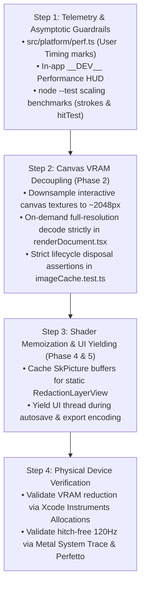

# Final Synthesis: Tuck Performance Engineering Strategy

Following a structured three-way debate between **Position A** (Runtime & Memory Architecture First), **Position B** (Infrastructure & Benchmark Baselines First), and **Position C** (Minimalist Native Profiling & Targeted Hotfixes Only), this synthesis integrates the arguments, evidence, concessions, and crux resolutions to deliver the definitive technical strategy for executing `docs/plans/performance/plan.md`.

---

## 1. Points of Agreement & Unanimous Concessions
Across three rounds of rigorous exchange, all three debaters converged on several fundamental realities:

1. **The 24MP VRAM Crisis is Tuck's #1 Crash Risk**:
   Every agent conceded that `MAX_PHOTO_PIXELS = 25_000_000` (`src/photos/photoScale.ts#L7`) decodes 24MP images into uncompressed ~98 MB GPU textures (`src/editor/render/decodedImages.ts#L9-L13`). Holding multiple full-resolution textures in the interactive canvas provides zero perceptible visual benefit on 1080p mobile viewports while routinely triggering fatal iOS Jetsam terminations and mobile browser tab crashes.
2. **Headless Browser Automation (Playwright) is Withdrawn**:
   Debater B formally withdrew the proposal for Tier 2 Playwright CI automation. All agents agreed that headless Chromium running on 32GB desktop CI runners cannot simulate mobile unified memory constraints, iOS Jetsam thresholds, Android Low Memory Killer (LMK), Metal/Vulkan GPU command scheduling, or physical 120Hz touch digitizer synchronization. Introducing multi-gigabyte browser binaries would impose high CI maintenance drag for misleading memory metrics.
3. **Standardized Zero-Overhead Spans (`src/platform/perf.ts`) are Essential**:
   All agents unanimously endorsed implementing `src/platform/perf.ts` wrapping `performance.mark` and `performance.measure`. These spans provide standardized diagnostic visibility across Chrome DevTools, Hermes tracing, and native profilers with zero bundle overhead in release builds (tree-shaken outside `__DEV__`) and full compliance with Tuck's offline, zero-telemetry Content Security Policy (`vercel.json`).
4. **Export Fidelity Invariants are Inviolate**:
   Any preview downsampling or canvas optimization must preserve bit-for-bit visual fidelity in exported documents (`src/editor/render/renderDocument.tsx`).

---

## 2. Crux Analysis & Resolution

### Crux 1: Structural Preview Decoupling vs. Parameter Tuning & Hotfixes
- **The Stances**: Position C advocated a simple hotfix (lowering `MAX_PHOTO_PIXELS` from 25MP to 16MP and tightening `afterSkiaDraws`), arguing that structural decoupling introduces dual-cache synchronization risks. Positions A and B argued that structural decoupling (downsampling the live canvas to ~2048px while reserving full-res decode exclusively for export) is an inescapable physical necessity for multi-layer documents.
- **Evidence & Resolution**:
  - Lowering `MAX_PHOTO_PIXELS` to 16MP degrades 24MP iPhone photos upon export, violating Hard Constraint 4, while still allocating ~64 MB of VRAM per layer (still fatal on 3–5 photo projects under iOS Jetsam).
  - Position A resolved the dual-cache complexity critique by narrowing the architectural scope: full-resolution textures are **never** held concurrently in memory during editing. The interactive canvas holds only the downsampled ~2048px texture; full-resolution decode occurs **strictly on-demand during offscreen export** in `renderDocument.tsx` and is disposed immediately upon snapshot creation.
  - **Verdict**: **Resolved in favor of Position A (Structural Preview Decoupling with On-Demand Export Decode)**.

### Crux 2: Worklet Math Microbenchmarks vs. Diagnostic Engine Divergence
- **The Stances**: Position B argued that pure CPU math in UI worklets (`geometry.ts`, `hitTest.ts`, `strokes.ts`) must have automated microbenchmarks in CI to prevent $O(N) \to O(N^2)$ regressions. Positions A and C countered that pure matrix math takes nanoseconds and that frame drops in Tuck are overwhelmingly GPU-bound (redaction shaders in `RedactionLayerView.tsx`). Furthermore, Node.js V8 JIT benchmarks optimize for the wrong runtime compared to Hermes 0.88 AOT bytecode.
- **Evidence & Resolution**:
  - The evidence confirms that frame drops during gestures are dominated by Skia GPU shader evaluation (multi-pass `pixelateFilter` and Gaussian blur), not affine matrix transformations.
  - However, Agent B successfully showed that stroke segmentation (`strokes.ts#L125-L155`) and layer hit-testing across 100 layers (`hitTest.ts#L39-L55`) scale asymptotically; an unintended $O(N^2)$ regression will hitch the 8.3ms frame budget on Hermes just as on V8.
  - Because Tuck already runs tests via native `node --test` (`package.json#L15`), adding lightweight scaling assertions for stroke reduction and multi-layer hit-testing incurs zero new dependencies, zero CI slowdown, and guards against algorithmic rot.
  - **Verdict**: **Resolved via Pragmatic Compromise**. Retain zero-dependency `node --test` benchmarks strictly focused on asymptotic scaling ($N=100$ layers, long stroke point arrays), while rejecting broad synthetic microbenchmarks that attempt to benchmark V8 as a proxy for Hermes.

### Crux 3: Headless Web End-to-End Testing vs. In-App Dev HUD & Native Profilers
- **The Stances**: Position B initially proposed headless Playwright suites to assert WebGL context retention and memory leaks. Positions A and C insisted on an in-app `__DEV__` HUD paired with real-device native profilers.
- **Evidence & Resolution**:
  - WebGL context exhaustion is already structural: `src/editor/render/drawOffscreen.web.ts` pools a single shared `SkSurface` with an idle timer.
  - Playwright measures desktop V8 JS heap, completely missing C++ Skia GPU texture allocations.
  - **Verdict**: **Resolved unanimously in favor of Positions A & C**. Reject Playwright. Implement the lightweight in-app `__DEV__` HUD (monitoring frame deltas, active texture counts, and estimated VRAM) and rely on Xcode Instruments (Metal System Trace / Allocations), Android Studio Profiler, and Chrome DevTools for ground-truth verification.

---

## 3. Conditional Winners: When Each Position Applies
- **Position A (Runtime & Memory Architecture First)** wins under the current conditions of Tuck: a production mobile app facing acute, well-understood VRAM pressure (~98 MB/layer) and GPU shader hitches on real devices. Direct architectural decoupling and filter memoization deliver immediate, high-magnitude stability improvements.
- **Position B (Infrastructure & Benchmark Baselines First)** would be the correct choice if Tuck had a large, distributed contributor base where subtle mathematical and algorithmic regressions routinely slip past code review, or if Tuck were primarily a desktop web SaaS where automated Playwright CI pipelines mirror the end-user deployment target.
- **Position C (Minimalist Native Profiling & Targeted Hotfixes Only)** would be the correct choice if Tuck were already architecturally mature with low memory pressure, where performance issues were isolated edge cases and every developer had physical test benches for continuous profiling.

---

## 4. Final Recommendation & Sequenced Roadmap

Evaluating the debate outcomes against the weighted criteria:
- **OOM & Crash Prevention (30%)**: Phase 2 preview downsampling eliminates the 98 MB/layer VRAM threat, slashing canvas memory by ~80% (~16 MB vs ~98 MB).
- **Interaction Fidelity & Frame Rate (25%)**: Phase 4 `SkPicture` memoization eliminates 8 dynamic shader stages per frame in `RedactionLayerView.tsx`, and Phase 5 UI yielding stops autosave hitching.
- **Engineering Cost & Maintenance Overhead (20%)**: Eliminating Playwright and leveraging native `node --test` preserves Tuck's millisecond test execution with zero external dependencies.
- **Diagnostic Realism & Platform Parity (15%)**: Standardized `src/platform/perf.ts` spans and an in-app Dev HUD provide direct integration with native iOS/Android/Web profilers.
- **Architectural Safety & Regression Protection (10%)**: Decoding full-resolution textures strictly on-demand during export preserves bit-for-bit export parity while avoiding dual-cache lifecycle bugs.

### Sequenced Implementation Roadmap

1. **Milestone 1 — Zero-Cost Telemetry & Guardrails**:
   - Create `src/platform/perf.ts` and `src/platform/perf.web.ts` using `performance.mark` and `performance.measure`.
   - Add a lightweight `__DEV__` diagnostic HUD overlay (`src/editor/shell/DevPerformanceHud.tsx`) tracking frame times, texture counts, and estimated VRAM.
   - Add zero-dependency scaling tests in `src/editor/canvas/hitTest.bench.ts` and `src/editor/layers/strokes.bench.ts` using native `node --test`.
2. **Milestone 2 — Canvas VRAM Decoupling (Phase 2)**:
   - Decouple the interactive canvas texture size (downsampling to a max dimension of 2048px, ~16 MB VRAM).
   - Ensure full-resolution images (up to `MAX_PHOTO_PIXELS = 25_000_000`) are decoded strictly on-demand during offscreen export in `src/editor/render/renderDocument.tsx` and disposed immediately upon completion.
   - Add unit tests in `src/editor/render/__tests__/imageCache.test.ts` verifying that texture releases and cache cleanup run without race conditions.
3. **Milestone 3 — Redaction Memoization & UI Yielding (Phase 4 & 5)**:
   - Cache `SkPicture` / filter buffers for static redactions in `src/editor/layers/redaction/RedactionLayerView.tsx`, eliminating redundant multi-pass displacement shader passes during pan/zoom gestures.
   - Introduce cooperative UI yielding (`requestAnimationFrame` / microtask chunking) during debounced autosave serialization and base64 export encoding.
4. **Milestone 4 — Real-Device Verification**:
   - Verify VRAM footprint on physical iOS devices using Xcode Instruments (Allocations/Leaks) and Android Studio Profiler.
   - Verify hitch-free 120Hz frame rates using Metal System Trace and Perfetto.
